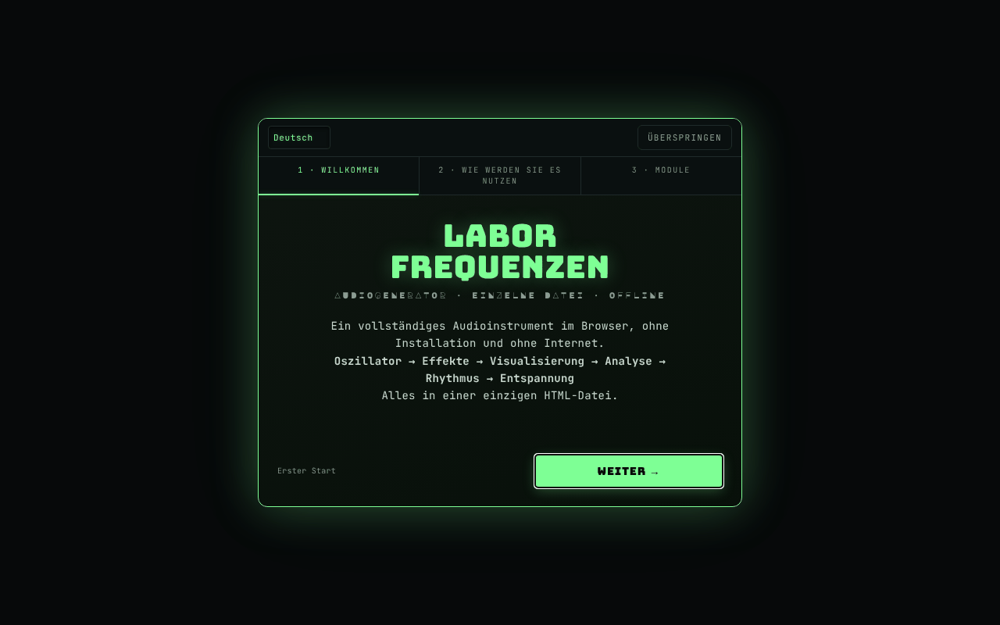

# Frequency Laboratory

[English](README.md) · [Română](README.ro.md) · [Français](README.fr.md) · [Italiano](README.it.md) · [Español](README.es.md) · [Português](README.pt.md) · **Deutsch** · [Magyar](README.hu.md)

**Version:** 5.2.0 · **Zuletzt aktualisiert:** 2026-10-27

**Status:** stabil · **Offline:** vollständig

Oberflächensprachen: **Română, English, Français, Italiano, Español, Português (PT), Deutsch, Magyar**

Kompletter Audiogenerator im Browser: Oszillatoren, Binaural, Filter, Effekte, Klavier, Analysatoren und Hörtests.

**Live-App:** https://chiuta.github.io/FrequencyLaboratory/

## Was es ist

Frequency Laboratory (v4.2.0 im Titel der App) ist ein Audiolabor in einer einzigen HTML-Datei auf Basis der Web Audio API. Es kombiniert Tongenerator, Synthese, Effekte, programmierbare Sessions, Messwerkzeuge mit dem Mikrofon und eine Frequenzdatenbank (Solfeggio, Schumann, binaural, Stimmungen usw.). Die App weist darauf hin, dass sie keine medizinische Behandlung ist und dass die Frequenzkategorien informativ sind.

## Funktionen

Die folgenden Funktionen erscheinen als Abschnitte/Bedienelemente in der Oberfläche:

- **Erzeugung:** Osc A und Osc B (Sinus, Rechteck, Dreieck, Sägezahn), Binaural-Modus (Δ binaural), Hard Sync, ADSR, Portamento, Filter (Tiefpass/Hochpass/Bandpass, Notch, Shelf, Peaking, Comb), Sweep, AM-/isochrone Modulation (ISO 2/6/10/40 Hz), weißes/rosa/braunes Rauschen.
- **Synthese und Effekte:** Akkorde und Arpeggiator, Suboszillator und Supersaw, FM, Ring, Auto-Pan, Drive/Kompressor/5-Band-EQ/Gate/Chorus/Flanger/Delay/Reverb, Vokal-Formantfilter, LFO-Modulationsmatrix, Akkordfolgen-Player, 8-Schritt-Step-Sequencer, Karplus-Strong, Granularsynthesizer, Looper, Stimmungen (12-TET, rein, pythagoreisch, 19-TET, 31-TET, Raga, Gamelan usw.).
- **Klavier und MIDI:** Tastatur, geschriebene Noten (z. B. A4), Tap-Tempo, MIDI IN (Web MIDI, nur in Browsern, die es unterstützen), MIDI-Zuordnungen.
- **Analyse:** Oszilloskop, FFT-Spektrum, Spektrogramm, Histogramm, Phasenscope (Lissajous), Terz-RTA, geschätzter THD, Mikrofon-Tuner, SPL-Messer mit Kalibrierung, Raummessung (Room Sweep) mit CSV-Export.
- **Tests:** Kanalidentifikation, Polarität, Impuls/Chirp, Einspielen von Lautsprechern, interaktives Audiogramm (PNG-Export), Spiel „Frequenz erkennen“, Tinnitus-Matcher mit Notch-Maskierung, „Mosquito“-Töne.
- **Umgebungsklänge**, prozedural erzeugt (Regen, Ozean, Wind, Feuer, Wald).
- **Sessions:** programmierbare Phasen mit Crossfade, Vorlagen Meditation / Einschlafen / Solfeggio, Sleep-Timer mit Ausblenden, 16-Bit-WAV-Aufnahme mit Pre-Roll.
- **Daten:** Benutzer-Presets, Favoriten, JSON-Export/-Import, Undo/Redo, Teilen der Konfiguration per URL, Teilen von WAV/JSON (Web Share), Farbthemen (Phosphor, Amber, Blue, Mono), Wake Lock, Tutorial.
- Oberfläche in 8 Sprachen (RO, EN, FR, IT, ES, PT, DE, HU); zuerst wird die gespeicherte Sprache verwendet, dann die Browsersprache (sonst EN), und die mit dem Sprachwähler getroffene Wahl bleibt erhalten. Die Hilfe (ELI5), die Nutzungshinweise, das Tutorial, die Änderungsprotokolle und der Frequenzkatalog (rund 230 Einträge mit Namen und Beschreibungen) gibt es in allen 8 Sprachen, und die RO-Variante, in der rund 800 Texte nur auf Englisch vorlagen, ist jetzt übersetzt; Eigennamen, Formate/Codes und die Standardnamen der musikalischen Modi bleiben unverändert. Die Übersetzungen außer RO und EN sind automatisch und nicht von Muttersprachlern geprüft.

## Bedienungsanleitung

1. Öffne die Seite und gehe bei Bedarf das Tutorial durch (`★ TUTORIAL`).
2. Stelle die Frequenz in „Osc A“ und die Wellenform ein; halte die „Master“-Lautstärke anfangs unter 20 % (Hinweis der App).
3. Drücke `START ▶` (oder die Leertaste); `STOP ◼` hält an; `PANIC ✕` (oder `P`) stoppt sofort.
4. Für Binaural starte „Osc B“, aktiviere den „Binaural-Modus“ und stelle „Δ binaural“ ein; verwende Kopfhörer.
5. Erkunde die Abschnitte in der Modulleiste (Akkorde, Effekte, Klavier, RTA, Audiogramm, Ambient, Presets, Database usw.).
6. Tastenkürzel: Leertaste Start/Stopp, `P` Panic, `R` Aufnahme, `↑/↓` Frequenz A ±1 Hz, `Shift+↑/↓` ±10 Hz, `1–4` Wellenform, `[` / `]` Master-Lautstärke ∓5 %, `S` Einrasten auf Note, `D` Drone, `?` Liste der Tastenkürzel, `Esc` schließt.
7. Aufnahme: `▶ START RECORDING`, dann `↓ DOWNLOAD WAV`.
8. Presets: mit Namen speichern, dann `↑ EXPORT JSON` für das Backup und `↓ IMPORT JSON` zum Wiederherstellen (der Import wird mit den vorhandenen Presets zusammengeführt).
9. Das Mikrofon (SPL, Tuner, RTA mit Mikrofon, Room Sweep) wird nur auf Anforderung aktiviert; der Browser fragt nach der Berechtigung.

## Datenschutz und Netzwerk

- **Lokale Speicherung:** `localStorage`, Schlüssel mit dem Präfix `frequencylaboratory.` (Sprache, Design, Presets, Favoriten, MIDI-Zuordnungen, Reihenfolge/Zustand der Module, Onboarding-Markierungen). Das Löschen der Websitedaten löscht die Presets; nutze den JSON-Export als Backup.
- **Netzwerk:** Die App stellt keine `fetch`-Anfragen und lädt keine externen Skripte oder Schriften. Die CSP in der Seite beschränkt `connect-src` auf `'self'`. Die Links (Buy Me a Coffee, alexio.tf, creativecommons.org) sind Hyperlinks, die nur per Klick geöffnet werden.
- Das Mikrofon wird lokal verwendet, nur nach Erteilung der Berechtigung; die App sendet das Audio nirgendwohin.

## Hinweis

Informativer/bildender Inhalt. Die App ist kein Medizinprodukt und keine Behandlung und ersetzt keinen ärztlichen Rat (auch nicht bei Tinnitus, Schmerzen oder Hörproblemen). Die „Solfeggio“-, „Schumann“-Frequenzen, die binauralen/isochronen Rhythmen und die in der Oberfläche als „Pain Relief“ oder „Peak Performance“ bezeichneten Presets haben keine wissenschaftliche Validierung als Therapie und keine nachgewiesene medizinische Wirkung (die Namen der Presets bleiben als Richtbezeichnungen erhalten; die Oberfläche zeigt den Hinweis daneben an, in der Oberflächensprache); die Seite selbst warnt im Preset-Bereich. Verwende eine niedrige Lautstärke (anfangs unter 20 %), besonders mit Kopfhörern; vermeide hohe Frequenzen bei hoher Lautstärke. Das Audiogramm ersetzt kein ärztliches Audiogramm. Die Hinweise zum Hörtest und zur Sicherheit sowie die Beschreibungen im Frequenzkatalog (Solfeggio, Gehirnwellen, Schumann usw., die in den Quellen therapeutische Behauptungen tragen) wurden automatisch übersetzt und müssen von einer Fachperson geprüft werden.

## Lokale Ausführung / offline

Lade `index.html` herunter und öffne sie im Browser; sie benötigt kein Internet. MIDI funktioniert nur dort, wo Web MIDI vorhanden ist (z. B. Chrome Desktop), und der Mikrofonzugriff erfordert einen sicheren Kontext (HTTPS oder lokale Datei, je nach Browser).

## Lizenz

MIT — siehe Datei LICENSE

## Audit

2026-10-11 (Runde 3): Die vom Audit hinzugefügten Bezeichnungen und der Hinweis sind ins RO/EN übersetzt (benötigen muttersprachliche Prüfung); Hinweis „keine nachgewiesene medizinische Wirkung“ neben den Presets Pain Relief / Peak Performance / Solfeggio.

2026-10-10: geprüft (keine Netzwerkanfragen im Code, CSP `connect-src 'self'`); zugängliche Namen für Bedienelemente, Kontrast und Warnhinweis in der Fußzeile ergänzt.

## Autor

Alexio — Alexandru-Ionuț Chiuță, Kontakt: alexio@trom.tf

## Zusammenfassung

Frequency Laboratory ist ein Web-Audio-Werkzeugkasten in einer einzigen Datei: Oszillatoren und binaurale Schwebungen, Filter und Effekte, Klavier/MIDI, Sequencer, Analysatoren (FFT, RTA, Phasenscope), mikrofonbasierte SPL- und Raummessung, Hörtests, Umgebungsklänge, programmierbare Sessions, WAV-Aufnahme und eine Frequenzdatenbank. Oberfläche in 8 Sprachen (RO, EN, FR, IT, ES, PT, DE, HU). Der Zustand wird in localStorage gehalten (Schlüssel `frequencylaboratory.`); die App stellt keine Netzwerkanfragen (CSP `connect-src 'self'`). Sie ist kein Medizinprodukt.

## Gehörschutz und Lautstärkebegrenzer (5.1.0)

Beim Start erscheint ein Hinweis mit Bestätigung („Verstanden — Ton aktivieren“): bis dahin ist die Audioausgabe stumm. Ein **Lautstärkebegrenzer** (Obergrenze für den gesamten Ton an Lautsprecher/Kopfhörer, auch für den Hörtest) ist eingebaut: standardmäßig −6 dB, einstellbar von −30 dB bis 0 dB über das Feld „GRENZE … dB“ im Kopfbereich; die Grenze wird in `localStorage` (`frequencylaboratory.volcap`) gespeichert, die Bestätigung nur für die Sitzung. Die „Master“-Lautstärke bleibt innerhalb der Grenze; aufgenommene Dateien (WAV) sind nicht betroffen. Kein Medizinprodukt: beginne mit minimaler Gerätelautstärke.

## Siehe auch: FrequencyLaboratory

**FrequencyLaboratory** (diese App) und **Frequency Laboratory (generator-frecvente)** teilen sich eine Codebasis und überschneiden sich stark. FrequencyLaboratory ist die neuere, vollständigere Version; generator-frecvente behält die klassische Einzelpanel-Oberfläche und hat die Szenenbibliothek. Die beiden Apps wurden NICHT zusammengeführt; sie nutzen getrennte Speicherschlüssel und können eine Konfiguration per Link (`#state=`) übergeben. generator-frecvente: https://chiuta.github.io/generator-frecvente/

## Modus „Einfacher Generator“ und Szenenbibliothek (v5.2.0)

Die Schaltfläche **„Modus Einfacher Generator“** zeigt nur die Panels des klassischen Generators [generator-frecvente](https://chiuta.github.io/generator-frecvente/) und die neue Szenenbibliothek; alles andere ist **ausgeblendet, nicht entfernt**, der volle Modus ist einen Klick entfernt (Wahl wird gemerkt). Die **Szenenbibliothek** (aus generator-frecvente kopierte Logik) enthält 6 eingebaute und eigene Szenen: Suche, Laden in Sitzungen, Abspielen, Export/Import (JSON `gf-scenes`), Plan-CSV und einen Teilen-Code `GF1.…`, der mit generator-frecvente kompatibel ist. Es sind nur Folgen von Frequenzen und binauralen Schwebungen, informativ und experimentell. Gehörwarnung und Lautstärkebegrenzer gelten in beiden Modi. generator-frecvente bleibt unverändert verfügbar. Die neuen Texte wurden auf Rumänisch und Englisch geschrieben; die Übersetzungen FR/IT/ES/PT/DE/HU sind automatisch (maschinelle Übersetzung, nicht von Muttersprachlern geprüft).

## Verlauf / Changelog

- **5.2.0 — 2026-10-27:** Modus „Einfacher Generator“ + Szenenbibliothek (6 eingebaute, Export/Import, CSV, Code `GF1.`); Gehörwarnung und Begrenzer in beiden Modi; neue Testdatei; CHANGELOG.md (vorher: v5.1.0).
- **5.1.0 — 2026-10-27:** Gehörschutz-Hinweis mit Bestätigung vor dem ersten Ton + Lautstärkebegrenzer (Obergrenze, Standard −6 dB, einstellbar); Hinweis „Siehe auch“ FrequencyLaboratory; Zeilen Status/Offline; CHANGELOG.md (vorher: v5.0.0).
- **4.3.9 — 2026-10-22:** Touch-Ziele: die ELI5-„?“-Marken erreichen 24×24 px (44 px bei grobem Zeiger). Erneute Prüfung bei 360 und 1366 px (Anfangszustand, aufgeklappte Abschnitte, verborgene Panels): kein Ziel unter 24 px und kein Text unter 12 px mehr.

### 4.3.13 — 2026-10-23

- Fix: user presets with wrongly typed fields (e.g. string `freqA`, missing `beatRate`) no longer break the presets panel; CSP hash recalculated.

### 4.3.12 — 2026-10-23

- Fix: startup no longer fails when `module_order_v1` or `midi_mappings` in localStorage are corrupt (object/`null`/number); CSP hash recalculated.

### 4.3.11 — 2026-10-23

- Dialoge: Die nativen Boxen `alert`/`confirm`/`prompt` wurden durch barrierefreie, übersetzte `FFF.dialog`-Dialoge ersetzt (Tastatur, Fokusfalle, Esc) – mit unverändertem Verhalten (fff-kit 1.2.0).

### 4.3.8 — 2026-10-22

fff-kit 1.1.4: Touch-Ziele und Mindestschriftgröße. Touch-Ziele/Text in der App korrigiert.

### 4.3.7 — 2026-10-22

fff-kit 1.1.2: PBKDF2 mit 600.000 Iterationen, Schutz vor Clickjacking.

### 4.3.6 — 2026-10-22

eigene `localStorage`-Schlüssel mit dem Präfix `frequencylaboratory.`, automatisch aus den alten `lab_frecv_`-Schlüsseln migriert (die auf derselben Origin mit Generator de frecvențe kollidierten); importierte Presets werden geprüft (nur bekannte Felder, richtige Typen, endliche Zahlen: ein Wert `1e309` zerstört die Audio-Parameter nicht mehr); echter Service Worker und Manifest (Offline-Start, installierbar); Versionsnummer aus dem Seitentitel entfernt; sichtbarer Tastaturfokus bei jedem Steuerelement. Feinschliff für Mobilgeräte und Barrierefreiheit: Text mit mindestens 12 px und Touch-Ziele von mindestens 24 px.

### 4.3.5 — 2026-10-22
- Übersetzungskorrektur: vier Hilfetexte, die in der rumänischen Oberfläche noch halb englisch waren, sind jetzt vollständig rumänisch; die Statusanzeigen für Sleep-Fade, Matrix, MIDI-Clock, Spektrogramm-Puffer und Audio-Kontext folgen jetzt der Oberflächensprache.

### 4.3.4 — 2026-10-22
- Übersetzungskorrektur: Die barrierefreien Namen (Share URL, Pluck, Module, Schaltflächen „einfache Erklärung“) folgen jetzt der Oberflächensprache, statt Rumänisch einzumischen; der Seitentitel folgt der Sprache; sieben rumänische Hilfetexte (und ein Hinweis zur Drum-Machine) wurden korrekt neu geschrieben, statt Englisch und Rumänisch zu mischen.

### 4.3.3 — 2026-10-22
- Behoben: Der rumänische zugängliche Name der Schaltfläche Wake lock beginnt jetzt mit dem sichtbaren Text („Wake lock – menține ecranul activ“), gemäß WCAG Label in Name.

### 4.3.2 — 2026-10-19
- Die Barrierefreiheits-Skripte der App sind wieder vorhanden: automatische zugängliche Namen für Steuerelemente ohne Beschriftung, Ersatzschrift für die Buchstaben Ă ă Ș ș Ț ț in den Anzeigeschriften und die Regel „sichtbarer Text im zugänglichen Namen“ (WCAG 2.5.3). Sie waren bei einer früheren Bereinigung versehentlich entfernt worden und wurden wiederhergestellt, mit den Suffixen der erzeugten Namen in 8 Sprachen. Bekanntes kleines Problem: In der RO-Oberfläche beginnt der zugängliche Name der Schaltfläche „Wake lock“ nicht mit ihrem sichtbaren Text.

### 4.3.1 — 2026-10-19
- Alle langen Texte (ELI5-Hilfe, Nutzungshinweise, Tutorial, Änderungsprotokolle, Frequenzkatalog) in 8 Sprachen; die rumänische Oberfläche, die noch rund 800 nur englische Texte hatte, ist übersetzt.

### 4.2.1 — 2026-10-19
- Korrektur: Beim Laden aus `#state=<base64>` stören zusätzliche Parameter in der Adresse (z. B. `&from=generator-frecvente`) die Dekodierung des Zustands nicht mehr.

### 4.2.0 — 2026-10-14
- Datensicherung und Datenkennzeichnung (fff-kit).

### 12. Oktober 2026 (v4.1.3)
- 4.1.3 — 2026-10-12: Die Version und das Datum der letzten Aktualisierung werden in der App angezeigt

### 11. Oktober 2026
- Erster Besuch: Die Standardsprache folgt der Browsersprache (Rumänisch → RO, sonst EN), statt immer RO zu sein; zuvor sahen Besucher mit englischem Browser eine gemischte RO/EN-Oberfläche.
- Die drei Benachrichtigungen (Toasts) beim Laden (Portamento, Mikrostimmung, „v4.1.2 geladen · MIDI“) wurden entfernt, da sie die Kopfzeile überlagerten; die MIDI-Meldung erscheint bei der Nutzung von MIDI. Auch das französische Wort „prêt“ in einer davon verschwindet.
- Die Spenden-Pille folgt der Sprache der Oberfläche (RO/EN), einschließlich der ARIA-Bezeichnungen.
- v4.1.2: Lautstärkewarnung (über 60 %, `role=status`, RO/EN) neben der Master-Lautstärke; Tastenkürzel `[` / `]` für die Lautstärke; CSP per Hash (kein `'unsafe-inline'` in `script-src`, `blob:` für Worklet/Aufnahme beibehalten). Offline getestet: 0 CSP-Fehler/-Verstöße, 0 horizontaler Überlauf, axe 0.
- Vereinheitlichte Version v4.1.2 (Titel, Kopfzeile, Manifest, Fußzeile; zuvor stand im Titel v4.0 und in der Fußzeile v4.1).
- Der Willkommensleitfaden (erster Start) hat jetzt die Schaltflächen RO/EN und „Überspringen“ (plus die Esc-Taste), ist ein barrierefreier Dialog und vollständig ins Englische übersetzt; die Module/Profile werden bei der Anzeige übersetzt. Auf niedrigen Bildschirmen schneidet er den oberen Teil nicht mehr ab.
- Die eingebetteten Anzeigeschriften enthalten kein Ă/Ș/Ț: Die betroffenen Elemente wechseln zur Textschrift (Klasse `dia-fb`), sodass der Titel keine Glyphen mehr mischt (z. B. „FRECVENȚE“, „CONTINUĂ“).
- Axe: 0 Verstöße (Inhalt in `<main>`, 18 Felder mit `aria-label`, h2-Überschriften in „Usage notes“, `aside` für Spenden, Benachrichtigungscontainer als Region). „uppended“ → „suspended“ im CTX-Indikator korrigiert.
