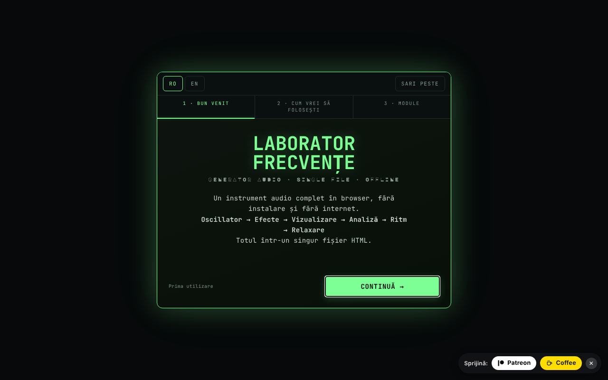

# Frequency Laboratory

[English](README.md) · [Română](README.ro.md) · [Français](README.fr.md) · [Italiano](README.it.md) · **Español** · [Português](README.pt.md) · [Deutsch](README.de.md) · [Magyar](README.hu.md)

**Versión:** 4.2.1 · **Última actualización:** 2026-10-19

Generador de audio completo en el navegador: osciladores, binaural, filtros, efectos, piano, analizadores y pruebas auditivas.

**Aplicación en línea:** https://chiuta.github.io/FrequencyLaboratory/

## Qué es

Frequency Laboratory (v4.2.0 en el título de la aplicación) es un laboratorio de audio en un único archivo HTML, basado en la Web Audio API. Combina generador de tonos, síntesis, efectos, sesiones programables, herramientas de medición con el micrófono y una base de datos de frecuencias (Solfeggio, Schumann, binaurales, afinaciones, etc.). La aplicación aclara que no es un tratamiento médico y que las categorías de frecuencias son informativas.

## Funciones

Las funciones siguientes aparecen como secciones/controles en la interfaz:

- **Generación:** Osc A y Osc B (seno, cuadrada, triangular, diente de sierra), modo binaural (Δ binaural), hard sync, ADSR, portamento, filtros (paso bajo/paso alto/paso banda, notch, shelf, peaking, comb), sweep, modulación AM/isocrónica (ISO 2/6/10/40 Hz), ruido blanco/rosa/marrón.
- **Síntesis y efectos:** acordes y arpegiador, suboscilador y supersaw, FM, ring, auto-pan, drive/compresor/ecualizador de 5 bandas/gate/chorus/flanger/delay/reverb, filtro de formantes vocales, matriz de modulación LFO, reproductor de progresiones de acordes, secuenciador por pasos de 8 pasos, Karplus-Strong, sintetizador granular, looper, afinaciones (12-TET, justa, pitagórica, 19-TET, 31-TET, raga, gamelán, etc.).
- **Piano y MIDI:** teclado, notas escritas (p. ej. A4), tap tempo, MIDI IN (Web MIDI, solo en navegadores que lo admiten), asignaciones MIDI.
- **Análisis:** osciloscopio, espectro FFT, espectrograma, histograma, osciloscopio de fase (Lissajous), RTA en tercios de octava, THD estimada, afinador con micrófono, sonómetro SPL con calibración, medición de sala (room sweep) con exportación CSV.
- **Pruebas:** identificación de canales, polaridad, impulso/chirp, rodaje de altavoces, audiograma interactivo (exportación PNG), juego «identifica la frecuencia», tinnitus matcher con enmascaramiento notch, tonos «mosquito».
- **Sonidos ambientales** generados de forma procedural (lluvia, océano, viento, fuego, bosque).
- **Sesiones:** etapas programables con crossfade, plantillas de Meditación / Conciliar el sueño / Solfeggio, temporizador de sueño con fundido, grabación WAV de 16 bits con pre-roll.
- **Datos:** preajustes de usuario, favoritos, exportación/importación JSON, deshacer/rehacer, compartir la configuración por URL, compartir WAV/JSON (Web Share), temas de color (Phosphor, Amber, Blue, Mono), Wake Lock, tutorial.
- Interfaz en rumano e inglés; en la primera visita el idioma sigue al del navegador (rumano → RO, en otro caso EN), y se conserva la elección hecha con los botones RO/EN. Atención: en la versión RO muchas etiquetas técnicas siguen en inglés (waveform, reverb, cutoff, etc.).

## Manual de uso

1. Abre la página y, si hace falta, recorre el tutorial (`★ TUTORIAL`).
2. Ajusta la frecuencia en «Osc A» y la forma de onda; mantén el volumen «master» por debajo del 20 % al principio (aviso de la aplicación).
3. Pulsa `START ▶` (o Espacio); `STOP ◼` detiene; `PANIC ✕` (o `P`) detiene al instante.
4. Para binaural, arranca «Osc B», activa el «modo binaural» y ajusta el «Δ binaural»; usa auriculares.
5. Explora las secciones de la barra de módulos (Acordes, Efectos, Piano, RTA, Audiograma, Ambient, Presets, Database, etc.).
6. Atajos: Espacio start/stop, `P` panic, `R` grabación, `↑/↓` frecuencia A ±1 Hz, `Shift+↑/↓` ±10 Hz, `1–4` forma de onda, `[` / `]` volumen master ∓5 %, `S` ajuste a la nota, `D` drone, `?` lista de atajos, `Esc` cierra.
7. Grabación: `▶ START RECORDING`, luego `↓ DOWNLOAD WAV`.
8. Preajustes: guarda con un nombre, luego `↑ EXPORT JSON` para la copia de seguridad y `↓ IMPORT JSON` para restaurar (la importación se fusiona con los preajustes existentes).
9. El micrófono (SPL, afinador, RTA con micrófono, room sweep) se activa solo a petición; el navegador pide permiso.

## Privacidad y red

- **Almacenamiento local:** `localStorage`, claves con el prefijo `lab_frecv_` (idioma, tema, preajustes, favoritos, asignaciones MIDI, orden/estado de los módulos, marcas de onboarding). Borrar los datos del sitio elimina los preajustes; usa la exportación JSON como copia de seguridad.
- **Red:** la aplicación no realiza solicitudes `fetch` y no carga scripts ni fuentes externos. La CSP de la página limita `connect-src` a `'self'`. Los enlaces (Buy Me a Coffee, alexio.tf, creativecommons.org) son hipervínculos que se abren solo al hacer clic.
- El micrófono se usa en local, solo tras conceder el permiso; la aplicación no envía el audio a ninguna parte.

## Advertencia

Contenido informativo/educativo. La aplicación no es un producto sanitario ni un tratamiento médico y no sustituye el consejo médico (incluso para acúfenos, dolor o problemas de audición). Las frecuencias «Solfeggio», «Schumann», los ritmos binaurales/isocrónicos y los preajustes de la interfaz denominados «Pain Relief» o «Peak Performance» no tienen validación científica como terapia ni efecto médico demostrado (los nombres de los preajustes se mantienen como denominaciones orientativas; la interfaz muestra el aviso junto a ellos, en RO y EN); la propia página avisa en el panel de preajustes. Usa un volumen bajo (por debajo del 20 % al principio), sobre todo con auriculares; evita las frecuencias agudas a volumen alto. El audiograma no sustituye a una audiometría médica.

## Ejecución local / sin conexión

Descarga `index.html` y ábrelo en el navegador; no requiere internet. El MIDI solo funciona donde existe Web MIDI (p. ej. Chrome de escritorio), y el acceso al micrófono requiere un contexto seguro (HTTPS o archivo local, según el navegador).

## Licencia

MIT — véase el archivo LICENSE

## Auditoría

2026-10-11 (ronda 3): las etiquetas añadidas por la auditoría y el aviso están traducidos a RO/EN (requieren revisión nativa); aviso «sin efecto médico demostrado» junto a los preajustes Pain Relief / Peak Performance / Solfeggio.

2026-10-10: verificado (sin solicitudes de red en el código, CSP `connect-src 'self'`); añadidos nombres accesibles para los controles, contraste, aviso en el pie de página.

## Autor

Alexio — Alexandru-Ionuț Chiuță, contacto: alexio@trom.tf

## Resumen

Frequency Laboratory es un conjunto de herramientas Web Audio en un único archivo: osciladores y pulsos binaurales, filtros y efectos, piano/MIDI, secuenciador, analizadores (FFT, RTA, osciloscopio de fase), medición de SPL y de sala con micrófono, pruebas auditivas, sonidos ambientales, sesiones programables, grabación WAV y una base de datos de frecuencias. Interfaz en rumano/inglés. El estado se conserva en localStorage (claves `lab_frecv_`); la aplicación no realiza solicitudes de red (CSP `connect-src 'self'`). No es un producto sanitario.

## Historial / Changelog

### 4.2.1 — 2026-10-19
- Corrección: al cargar desde `#state=<base64>`, los parámetros adicionales de la dirección (p. ej. `&from=generator-frecvente`) ya no estropean la decodificación del estado.

### 4.2.0 — 2026-10-14
- Copia de seguridad y etiquetado de datos (fff-kit).

### 12 de octubre de 2026 (v4.1.3)
- 4.1.3 — 2026-10-12: la versión y la fecha de la última actualización se muestran en la aplicación

### 11 de octubre de 2026
- Primera visita: el idioma por defecto sigue al del navegador (rumano → RO, en otro caso EN) en lugar de ser siempre RO; antes los visitantes con navegador en inglés veían una interfaz mezclada RO/EN.
- Eliminadas las tres notificaciones (toasts) de la carga (portamento, microafinación, «v4.1.2 cargado · MIDI»), que se superponían a la cabecera; el mensaje sobre MIDI aparece al usar MIDI. Desaparece también la palabra francesa «prêt» de una de ellas.
- La píldora de donaciones sigue el idioma de la interfaz (RO/EN), incluidas las etiquetas ARIA.
- v4.1.2: aviso de volumen (por encima del 60 %, `role=status`, RO/EN) junto al volumen master; atajos `[` / `]` para el volumen; CSP por hash (sin `'unsafe-inline'` en `script-src`, `blob:` conservado para el worklet/grabación). Probado sin conexión: 0 errores/infracciones de CSP, 0 desbordamiento horizontal, axe 0.
- Versión unificada v4.1.2 (título, cabecera, manifiesto, pie de página; antes el título decía v4.0 y el pie v4.1).
- La guía de bienvenida (primera ejecución) tiene ahora botones RO/EN y «Omitir» (más la tecla Esc), es un diálogo accesible y está traducida por completo al inglés; los módulos/perfiles se traducen al mostrarse. En pantallas bajas ya no corta la parte superior.
- Las fuentes de visualización incorporadas no contienen Ă/Ș/Ț: los elementos afectados pasan a la fuente de texto (clase `dia-fb`), de modo que el título ya no mezcla glifos (p. ej. «FRECVENȚE», «CONTINUĂ»).
- Axe: 0 infracciones (contenido en `<main>`, 18 campos con `aria-label`, encabezados h2 en «Usage notes», `aside` para donaciones, contenedor de notificaciones como región). Corregido «uppended» → «suspended» en el indicador CTX.
