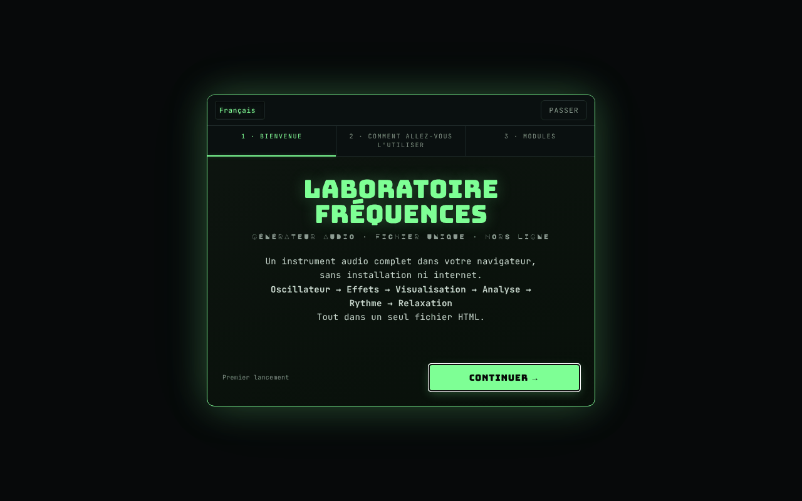

# Frequency Laboratory

[English](README.md) · [Română](README.ro.md) · **Français** · [Italiano](README.it.md) · [Español](README.es.md) · [Português](README.pt.md) · [Deutsch](README.de.md) · [Magyar](README.hu.md)

**Version :** 4.3.10 · **Dernière mise à jour :** 2026-10-23

Langues de l'interface : **Română, English, Français, Italiano, Español, Português (PT), Deutsch, Magyar**

Générateur audio complet dans le navigateur : oscillateurs, binaural, filtres, effets, piano, analyseurs et tests auditifs.

**Application en ligne :** https://chiuta.github.io/FrequencyLaboratory/

## De quoi s'agit-il

Frequency Laboratory (v4.2.0 dans le titre de l'application) est un laboratoire audio dans un seul fichier HTML, fondé sur la Web Audio API. Il combine générateur de tonalités, synthèse, effets, sessions programmables, outils de mesure avec le microphone et une base de données de fréquences (Solfeggio, Schumann, binaurales, accordages, etc.). L'application précise qu'elle n'est pas un traitement médical et que les catégories de fréquences sont données à titre informatif.

## Fonctions

Les fonctions ci-dessous apparaissent sous forme de sections/commandes dans l'interface :

- **Génération :** Osc A et Osc B (sinus, carré, triangle, dent de scie), mode binaural (Δ binaural), hard sync, ADSR, portamento, filtres (passe-bas/passe-haut/passe-bande, notch, shelf, peaking, comb), sweep, modulation AM/isochrone (ISO 2/6/10/40 Hz), bruit blanc/rose/brun.
- **Synthèse et effets :** accords et arpégiateur, sous-oscillateur et supersaw, FM, ring, auto-pan, drive/compresseur/égaliseur 5 bandes/gate/chorus/flanger/delay/reverb, filtre de formants vocaux, matrice de modulation LFO, lecteur de progressions d'accords, séquenceur pas à pas à 8 pas, Karplus-Strong, synthétiseur granulaire, looper, accordages (ET-12, juste, pythagoricien, 19-TET, 31-TET, raga, gamelan, etc.).
- **Piano et MIDI :** clavier, notes saisies (ex. A4), tap tempo, MIDI IN (Web MIDI, uniquement dans les navigateurs qui le prennent en charge), mappages MIDI.
- **Analyse :** oscilloscope, spectre FFT, spectrogramme, histogramme, scope de phase (Lissajous), RTA au tiers d'octave, THD estimé, accordeur par microphone, sonomètre SPL avec étalonnage, mesure de la pièce (room sweep) avec export CSV.
- **Tests :** identification des canaux, polarité, impulsion/chirp, rodage des enceintes, audiogramme interactif (export PNG), jeu « identifier la fréquence », tinnitus matcher avec masquage notch, tonalités « mosquito ».
- **Sons d'ambiance** générés de façon procédurale (pluie, océan, vent, feu, forêt).
- **Sessions :** étapes programmables avec fondu enchaîné, modèles Méditation / Endormissement / Solfeggio, minuterie de sommeil avec fondu, enregistrement WAV 16 bits avec pre-roll.
- **Données :** préréglages utilisateur, favoris, export/import JSON, annuler/rétablir, partage de la configuration par URL, partage WAV/JSON (Web Share), thèmes de couleur (Phosphor, Amber, Blue, Mono), Wake Lock, tutoriel.
- Interface en 8 langues (RO, EN, FR, IT, ES, PT, DE, HU) ; la langue enregistrée est utilisée en premier, puis celle du navigateur (sinon EN), et le choix fait avec le sélecteur de langue est conservé. L'aide (ELI5), les notes d'utilisation, le tutoriel, les journaux des modifications et le catalogue de fréquences (environ 230 entrées avec noms et descriptions) existent dans les 8 langues, et la version RO, où environ 800 textes n'existaient qu'en anglais, est désormais traduite ; les noms propres, les formats/codes et les noms standard des modes musicaux restent tels quels. Les traductions autres que RO et EN sont automatiques et n'ont pas été vérifiées par des locuteurs natifs.

## Mode d'emploi

1. Ouvrez la page et, au besoin, parcourez le tutoriel (`★ TUTORIAL`).
2. Réglez la fréquence dans « Osc A » et la forme d'onde ; gardez le volume « master » sous 20 % au début (avertissement de l'application).
3. Appuyez sur `START ▶` (ou Espace) ; `STOP ◼` arrête ; `PANIC ✕` (ou `P`) arrête instantanément.
4. Pour le binaural, démarrez « Osc B », activez le « mode binaural » et réglez le « Δ binaural » ; utilisez un casque.
5. Explorez les sections de la barre de modules (Accords, Effets, Piano, RTA, Audiogramme, Ambient, Presets, Database, etc.).
6. Raccourcis : Espace start/stop, `P` panic, `R` enregistrement, `↑/↓` fréquence A ±1 Hz, `Shift+↑/↓` ±10 Hz, `1–4` forme d'onde, `[` / `]` volume master ∓5 %, `S` aimantation à la note, `D` drone, `?` liste des raccourcis, `Esc` ferme.
7. Enregistrement : `▶ START RECORDING`, puis `↓ DOWNLOAD WAV`.
8. Préréglages : enregistrez avec un nom, puis `↑ EXPORT JSON` pour la sauvegarde et `↓ IMPORT JSON` pour la restauration (l'import est fusionné avec les préréglages existants).
9. Le microphone (SPL, accordeur, RTA par microphone, room sweep) n'est activé que sur demande ; le navigateur demande l'autorisation.

## Confidentialité et réseau

- **Stockage local :** `localStorage`, clés préfixées par `frequencylaboratory.` (langue, thème, préréglages, favoris, mappages MIDI, ordre/état des modules, repères d'onboarding). La suppression des données du site efface les préréglages ; utilisez l'export JSON pour la sauvegarde.
- **Réseau :** l'application n'effectue aucune requête `fetch` et ne charge ni scripts ni polices externes. La CSP de la page limite `connect-src` à `'self'`. Les liens (Buy Me a Coffee, alexio.tf, creativecommons.org) sont des hyperliens ouverts uniquement au clic.
- Le microphone est utilisé localement, uniquement après autorisation ; l'application n'envoie l'audio nulle part.

## Avertissement

Contenu informatif/éducatif. L'application n'est ni un dispositif médical ni un traitement et ne remplace pas un avis médical (y compris pour les acouphènes, la douleur ou les problèmes d'audition). Les fréquences « Solfeggio », « Schumann », les rythmes binauraux/isochrones et les préréglages de l'interface nommés « Pain Relief » ou « Peak Performance » n'ont aucune validation scientifique en tant que thérapie et aucun effet médical prouvé (les noms des préréglages sont conservés comme dénominations indicatives ; l'interface affiche l'avertissement à côté, dans la langue de l'interface) ; la page elle-même avertit dans le panneau des préréglages. Utilisez un volume faible (sous 20 % au début), surtout avec un casque ; évitez les fréquences aiguës à volume élevé. L'audiogramme ne remplace pas un audiogramme médical. Les notes sur le test auditif et la sécurité et les descriptions du catalogue de fréquences (solfège, ondes cérébrales, Schumann, etc., qui portent des allégations thérapeutiques dans les sources) sont traduites automatiquement et doivent être relues par un spécialiste.

## Exécution locale / hors ligne

Téléchargez `index.html` et ouvrez-le dans un navigateur ; il ne nécessite pas internet. Le MIDI ne fonctionne que là où Web MIDI existe (par ex. Chrome sur ordinateur), et l'accès au microphone requiert un contexte sécurisé (HTTPS ou fichier local, selon le navigateur).

## Licence

MIT — voir le fichier LICENSE

## Audit

2026-10-11 (tour 3) : les étiquettes ajoutées par l'audit et l'avertissement sont traduits RO/EN (révision native nécessaire) ; avertissement « sans effet médical prouvé » à côté des préréglages Pain Relief / Peak Performance / Solfeggio.

2026-10-10 : vérifié (aucune requête réseau dans le code, CSP `connect-src 'self'`) ; ajout de noms accessibles pour les commandes, contraste, avertissement dans le pied de page.

## Auteur

Alexio — Alexandru-Ionuț Chiuță, contact : alexio@trom.tf

## Résumé

Frequency Laboratory est une boîte à outils Web Audio dans un seul fichier : oscillateurs et battements binauraux, filtres et effets, piano/MIDI, séquenceur, analyseurs (FFT, RTA, scope de phase), mesure SPL et de pièce par microphone, tests auditifs, sons d'ambiance, sessions programmables, enregistrement WAV et base de données de fréquences. Interface en 8 langues (RO, EN, FR, IT, ES, PT, DE, HU). L'état est conservé dans localStorage (clés `frequencylaboratory.`) ; l'application n'effectue aucune requête réseau (CSP `connect-src 'self'`). Ce n'est pas un dispositif médical.

## Historique / Changelog
- **4.3.9 — 2026-10-22:** Cibles tactiles : les badges « ? » ELI5 atteignent 24×24 px (44 px sur pointeur grossier). Nouvel audit à 360 et 1366 px (état initial, sections développées, panneaux cachés) : plus aucune cible sous 24 px ni texte sous 12 px.

### 4.3.8 — 2026-10-22

fff-kit 1.1.4 : cibles tactiles et taille de texte minimale. Cibles tactiles/texte corrigés dans l’application.

### 4.3.7 — 2026-10-22

fff-kit 1.1.2 : PBKDF2 600 000 itérations, protection anti-clickjacking.

### 4.3.6 — 2026-10-22

clés `localStorage` propres avec le préfixe `frequencylaboratory.`, migrées automatiquement depuis les anciennes clés `lab_frecv_` (qui entraient en collision avec Generator de frecvențe sur la même origine) ; les préréglages importés sont validés (champs connus uniquement, types corrects, nombres finis : une valeur `1e309` ne casse plus les paramètres audio) ; vrai service worker et manifeste (démarrage hors ligne, installable) ; numéro de version retiré du titre de la page ; focus clavier visible sur chaque contrôle. finitions mobile et accessibilité : texte d’au moins 12 px et cibles tactiles d’au moins 24 px.

### 4.3.5 — 2026-10-22
- Correctif de traduction : quatre textes d’aide encore à moitié en anglais dans l’interface roumaine sont désormais entièrement en roumain ; les libellés d’état du sleep-fade, de la matrice, de l’horloge MIDI, du tampon de spectrogramme et du contexte audio suivent désormais la langue de l’interface.

### 4.3.4 — 2026-10-22
- Correction de traduction : les noms accessibles (Share URL, Pluck, Modules, boutons « explication simple ») suivent désormais la langue de l'interface au lieu de mélanger le roumain ; le titre de la page suit la langue ; sept textes d'aide en roumain (et une note de la boîte à rythmes) ont été réécrits correctement au lieu de mêler anglais et roumain.

### 4.3.3 — 2026-10-22
- Corrigé : le nom accessible roumain du bouton Wake lock commence désormais par le texte visible (« Wake lock – menține ecranul activ »), conformément à WCAG Label in Name.

### 4.3.2 — 2026-10-19
- Les scripts d'accessibilité de l'application sont de nouveau présents : noms accessibles automatiques pour les contrôles sans étiquette, police de secours pour les lettres Ă ă Ș ș Ț ț dans les polices d'affichage, et règle du texte visible dans le nom accessible (WCAG 2.5.3). Ils avaient été supprimés par erreur lors d'un nettoyage antérieur et ont été restaurés, avec les suffixes des noms générés en 8 langues. Problème mineur connu : dans l'interface RO, le nom accessible du bouton « Wake lock » ne commence pas par son texte visible.

### 4.3.1 — 2026-10-19
- Tous les textes longs (aide ELI5, notes d'utilisation, tutoriel, journaux des modifications, catalogue de fréquences) en 8 langues ; l'interface roumaine, qui comptait encore environ 800 textes uniquement en anglais, est traduite.

### 4.2.1 — 2026-10-19
- Correctif : lors du chargement depuis `#state=<base64>`, les paramètres supplémentaires présents dans l'adresse (par ex. `&from=generator-frecvente`) ne perturbent plus le décodage de l'état.

### 4.2.0 — 2026-10-14
- Sauvegarde et étiquetage des données (fff-kit).

### 12 octobre 2026 (v4.1.3)
- 4.1.3 — 2026-10-12 : la version et la date de la dernière mise à jour sont affichées dans l'application

### 11 octobre 2026
- Première visite : la langue par défaut suit celle du navigateur (roumain → RO, sinon EN) au lieu d'être toujours RO ; auparavant, les visiteurs avec un navigateur en anglais voyaient une interface mélangée RO/EN.
- Suppression des trois notifications (toasts) au chargement (portamento, micro-accordage, « v4.1.2 chargé · MIDI »), qui se superposaient à l'en-tête ; le message sur le MIDI apparaît à l'utilisation du MIDI. Le mot français « prêt » de l'une d'elles disparaît également.
- La pastille de dons suit la langue de l'interface (RO/EN), y compris les étiquettes ARIA.
- v4.1.2 : avertissement de volume (au-dessus de 60 %, `role=status`, RO/EN) à côté du volume master ; raccourcis `[` / `]` pour le volume ; CSP par hash (sans `'unsafe-inline'` dans `script-src`, `blob:` conservé pour le worklet/l'enregistrement). Testé hors ligne : 0 erreur/violation CSP, 0 débordement horizontal, axe 0.
- Version unifiée v4.1.2 (titre, en-tête, manifeste, pied de page ; auparavant le titre disait v4.0 et le pied de page v4.1).
- Le guide de bienvenue (première exécution) comporte désormais des boutons RO/EN et « Passer » (plus la touche Échap), est une boîte de dialogue accessible et est entièrement traduit en anglais ; les modules/profils sont traduits à l'affichage. Sur les écrans de faible hauteur, il ne coupe plus le haut.
- Les polices d'affichage intégrées ne contiennent pas Ă/Ș/Ț : les éléments concernés passent à la police de texte (classe `dia-fb`), si bien que le titre ne mélange plus les glyphes (par ex. « FRECVENȚE », « CONTINUĂ »).
- Axe : 0 violation (contenu dans `<main>`, 18 champs avec `aria-label`, titres h2 dans « Usage notes », `aside` pour les dons, conteneur de notifications comme région). Correction de « uppended » → « suspended » dans l'indicateur CTX.
