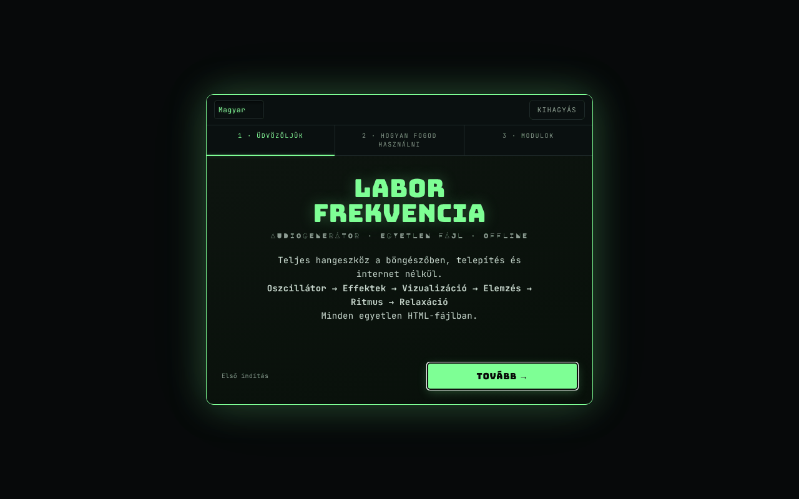

# Frequency Laboratory

[English](README.md) · [Română](README.ro.md) · [Français](README.fr.md) · [Italiano](README.it.md) · [Español](README.es.md) · [Português](README.pt.md) · [Deutsch](README.de.md) · **Magyar**

**Verzió:** 4.3.2 · **Utolsó frissítés:** 2026-10-19

A felület nyelvei: **Română, English, Français, Italiano, Español, Português (PT), Deutsch, Magyar**

Teljes értékű hanggenerátor a böngészőben: oszcillátorok, binaurális, szűrők, effektek, zongora, analizátorok és hallásvizsgálatok.

**Online alkalmazás:** https://chiuta.github.io/FrequencyLaboratory/

## Mi ez

A Frequency Laboratory (az alkalmazás címében v4.2.0) egy egyetlen HTML-fájlban lévő hanglabor, amely a Web Audio API-ra épül. Egyesíti a hanggenerátort, a szintézist, az effekteket, a programozható munkameneteket, a mikrofonos mérőeszközöket és egy frekvencia-adatbázist (Solfeggio, Schumann, binaurális, hangolások stb.). Az alkalmazás kimondja, hogy nem orvosi kezelés, és hogy a frekvenciakategóriák tájékoztató jellegűek.

## Funkciók

Az alábbi funkciók szakaszokként/vezérlőkként jelennek meg a felületen:

- **Generálás:** Osc A és Osc B (szinusz, négyszög, háromszög, fűrészfog), binaurális mód (binaurális Δ), hard sync, ADSR, portamento, szűrők (aluláteresztő/felüláteresztő/sáváteresztő, notch, shelf, peaking, comb), sweep, AM/izokron moduláció (ISO 2/6/10/40 Hz), fehér/rózsaszín/barna zaj.
- **Szintézis és effektek:** akkordok és arpeggiátor, szuboszcillátor és supersaw, FM, ring, auto-pan, drive/kompresszor/5 sávos EQ/gate/chorus/flanger/delay/reverb, vokális formánsszűrő, LFO-modulációs mátrix, akkordmenet-lejátszó, 8 lépéses step szekvencer, Karplus-Strong, granuláris szintetizátor, looper, hangolások (12-TET, tiszta, püthagoraszi, 19-TET, 31-TET, rága, gamelán stb.).
- **Zongora és MIDI:** billentyűzet, beírt hangok (pl. A4), tap tempo, MIDI IN (Web MIDI, csak az ezt támogató böngészőkben), MIDI-hozzárendelések.
- **Elemzés:** oszcilloszkóp, FFT-spektrum, spektrogram, hisztogram, fázisszkóp (Lissajous), tercoktáv-RTA, becsült THD, mikrofonos hangoló, SPL-mérő kalibrálással, szobamérés (room sweep) CSV-exporttal.
- **Tesztek:** csatornaazonosítás, polaritás, impulzus/chirp, hangszórók bejáratása, interaktív audiogram (PNG-export), „azonosítsd a frekvenciát” játék, tinnitus matcher notch-maszkolással, „mosquito” hangok.
- **Környezeti hangok**, procedurálisan generálva (eső, óceán, szél, tűz, erdő).
- **Munkamenetek:** programozható szakaszok crossfade-del, Meditáció / Elalvás / Solfeggio sablonok, alvásidőzítő kihalkítással, 16 bites WAV-felvétel pre-roll-lal.
- **Adatok:** felhasználói előbeállítások, kedvencek, JSON-export/-import, visszavonás/újra, a konfiguráció megosztása URL-en keresztül, WAV/JSON megosztása (Web Share), színtémák (Phosphor, Amber, Blue, Mono), Wake Lock, bemutató.
- 8 nyelvű felület (RO, EN, FR, IT, ES, PT, DE, HU); először a mentett nyelv érvényes, utána a böngészőé (egyébként EN), és a nyelvválasztóval hozott választás megmarad. A súgó (ELI5), a használati megjegyzések, az oktatóanyag, a változásnaplók és a frekvenciakatalógus (mintegy 230 bejegyzés névvel és leírással) mind a 8 nyelven megvan, és az RO változat, amelyben mintegy 800 szöveg csak angolul volt, most le van fordítva; a tulajdonnevek, a formátumok/kódok és a zenei módok szabványos nevei változatlanok maradnak. Az RO-tól és EN-től eltérő fordítások gépiek, és anyanyelvi beszélők nem ellenőrizték őket.

## Használati útmutató

1. Nyisd meg az oldalt, és szükség esetén menj végig a bemutatón (`★ TUTORIAL`).
2. Állítsd be a frekvenciát az „Osc A” részben és a hullámformát; kezdetben tartsd a „master” hangerőt 20% alatt (az alkalmazás figyelmeztetése).
3. Nyomd meg a `START ▶` gombot (vagy a szóközt); a `STOP ◼` leállít; a `PANIC ✕` (vagy `P`) azonnal leállít.
4. Binaurálishoz indítsd el az „Osc B”-t, kapcsold be a „binaurális módot”, és állítsd be a „binaurális Δ” értékét; használj fejhallgatót.
5. Fedezd fel a modulsáv szakaszait (Akkordok, Effektek, Zongora, RTA, Audiogram, Ambient, Presets, Database stb.).
6. Billentyűparancsok: szóköz start/stop, `P` panic, `R` felvétel, `↑/↓` A frekvencia ±1 Hz, `Shift+↑/↓` ±10 Hz, `1–4` hullámforma, `[` / `]` master hangerő ∓5%, `S` hangra igazítás, `D` drone, `?` a billentyűparancsok listája, `Esc` bezár.
7. Felvétel: `▶ START RECORDING`, majd `↓ DOWNLOAD WAV`.
8. Előbeállítások: mentsd el névvel, majd `↑ EXPORT JSON` a biztonsági mentéshez és `↓ IMPORT JSON` a visszaállításhoz (az import összefésülődik a meglévő előbeállításokkal).
9. A mikrofon (SPL, hangoló, mikrofonos RTA, room sweep) csak kérésre aktiválódik; a böngésző engedélyt kér.

## Adatvédelem és hálózat

- **Helyi tárolás:** `localStorage`, `lab_frecv_` előtagú kulcsok (nyelv, téma, előbeállítások, kedvencek, MIDI-hozzárendelések, a modulok sorrendje/állapota, onboarding-jelölők). A webhelyadatok törlése törli az előbeállításokat; biztonsági mentéshez használd a JSON-exportot.
- **Hálózat:** az alkalmazás nem indít `fetch` kéréseket, és nem tölt be külső szkripteket vagy betűtípusokat. Az oldalban lévő CSP a `connect-src` értékét `'self'`-re korlátozza. A hivatkozások (Buy Me a Coffee, alexio.tf, creativecommons.org) hiperhivatkozások, amelyek csak kattintásra nyílnak meg.
- A mikrofont helyben használja, csak az engedély megadása után; az alkalmazás a hangot sehová nem küldi el.

## Figyelmeztetés

Tájékoztató/oktatási tartalom. Az alkalmazás nem orvosi eszköz vagy kezelés, és nem helyettesíti az orvosi tanácsot (beleértve a fülzúgást, a fájdalmat vagy a hallásproblémákat). A „Solfeggio”, „Schumann” frekvenciák, a binaurális/izokron ritmusok és a felületen „Pain Relief” vagy „Peak Performance” néven szereplő előbeállítások terápiaként nem rendelkeznek tudományos validálással, és nincs bizonyított orvosi hatásuk (az előbeállítások nevei tájékoztató elnevezésként maradtak meg; a felület mellettük megjeleníti a figyelmeztetést, a felület nyelvén); maga az oldal is figyelmeztet az előbeállítások panelén. Használj alacsony hangerőt (kezdetben 20% alatt), különösen fejhallgatóval; kerüld a magas frekvenciákat nagy hangerőn. Az audiogram nem helyettesíti az orvosi audiogramot. A hallásvizsgálati és biztonsági megjegyzések, valamint a frekvenciakatalógus leírásai (solfeggio, agyhullámok, Schumann stb., amelyek a forrásokban terápiás állításokat hordoznak) gépi fordítások, és szakértői felülvizsgálatot igényelnek.

## Futtatás helyben / offline

Töltsd le az `index.html` fájlt, és nyisd meg a böngészőben; nem igényel internetet. A MIDI csak ott működik, ahol van Web MIDI (pl. asztali Chrome), a mikrofonhoz való hozzáféréshez pedig biztonságos környezet kell (HTTPS vagy helyi fájl, böngészőtől függően).

## Licenc

MIT — lásd a LICENSE fájlt

## Audit

2026-10-11 (3. kör): az audit által hozzáadott feliratok és a figyelmeztetés le van fordítva RO/EN nyelvre (anyanyelvi átnézést igényel); „nincs bizonyított orvosi hatás” figyelmeztetés a Pain Relief / Peak Performance / Solfeggio előbeállítások mellett.

2026-10-10: ellenőrizve (a kódban nincs hálózati kérés, CSP `connect-src 'self'`); hozzáférhető nevek a vezérlőkhöz, kontraszt, figyelmeztetés a láblécben hozzáadva.

## Szerző

Alexio — Alexandru-Ionuț Chiuță, kapcsolat: alexio@trom.tf

## Összefoglaló

A Frequency Laboratory egyetlen fájlból álló Web Audio eszköztár: oszcillátorok és binaurális ütemek, szűrők és effektek, zongora/MIDI, szekvencer, analizátorok (FFT, RTA, fázisszkóp), mikrofonos SPL- és szobamérés, hallásvizsgálatok, környezeti hangok, programozható munkamenetek, WAV-felvétel és egy frekvencia-adatbázis. 8 nyelvű felület (RO, EN, FR, IT, ES, PT, DE, HU). Az állapot a localStorage-ban van tárolva (`lab_frecv_` kulcsok); az alkalmazás nem indít hálózati kéréseket (CSP `connect-src 'self'`). Nem orvosi eszköz.

## Előzmények / Changelog

### 4.3.2 — 2026-10-19
- Az alkalmazás akadálymentességi szkriptjei ismét megvannak: automatikus hozzáférhető nevek a címke nélküli vezérlőkhöz, tartalékbetűtípus az Ă ă Ș ș Ț ț betűkhöz a megjelenítő betűtípusokban, és a „látható szöveg a hozzáférhető névben” szabály (WCAG 2.5.3). Egy korábbi takarításkor tévedésből eltávolították őket, és helyreállítottuk őket, a generált nevek utótagjai 8 nyelven. Ismert kisebb hiba: az RO felületen a „Wake lock” gomb hozzáférhető neve nem a látható szöveggel kezdődik.

### 4.3.1 — 2026-10-19
- Az összes hosszú szöveg (ELI5-súgó, használati megjegyzések, oktatóanyag, változásnaplók, frekvenciakatalógus) 8 nyelven; a román felület, amelyben még mintegy 800 csak angol szöveg volt, le van fordítva.

### 4.2.1 — 2026-10-19
- Javítás: a `#state=<base64>` címről történő betöltéskor a címben lévő további paraméterek (pl. `&from=generator-frecvente`) már nem rontják el az állapot dekódolását.

### 4.2.0 — 2026-10-14
- Biztonsági mentés és adatcímkézés (fff-kit).

### 2026. október 12. (v4.1.3)
- 4.1.3 — 2026-10-12: a verzió és az utolsó frissítés dátuma megjelenik az alkalmazásban

### 2026. október 11.
- Első látogatás: az alapértelmezett nyelv a böngésző nyelvét követi (román → RO, egyébként EN) ahelyett, hogy mindig RO lenne; korábban az angol böngészőt használó látogatók vegyes RO/EN felületet láttak.
- Eltávolítva a betöltéskor megjelenő három értesítés (toast) (portamento, mikrohangolás, „v4.1.2 betöltve · MIDI”), amelyek ráfedtek a fejlécre; a MIDI-ről szóló üzenet a MIDI használatakor jelenik meg. Az egyikből eltűnik a francia „prêt” szó is.
- Az adománygomb a felület nyelvét követi (RO/EN), az ARIA-feliratokat is beleértve.
- v4.1.2: hangerő-figyelmeztetés (60% felett, `role=status`, RO/EN) a master hangerő mellett; `[` / `]` billentyűparancsok a hangerőhöz; CSP hash-alapon (a `script-src`-ben nincs `'unsafe-inline'`, a `blob:` megmaradt a worklethez/felvételhez). Offline tesztelve: 0 CSP-hiba/-szabálysértés, 0 vízszintes túlcsordulás, axe 0.
- Egységesített v4.1.2 verzió (cím, fejléc, manifeszt, lábléc; korábban a cím v4.0-t, a lábléc v4.1-et mutatott).
- Az üdvözlő útmutató (első indítás) mostantól RO/EN gombokkal és „Kihagyás” gombbal (valamint az Esc billentyűvel) rendelkezik, hozzáférhető párbeszédpanel, és teljesen le van fordítva angolra; a modulok/profilok megjelenítéskor kerülnek lefordításra. Alacsony képernyőkön már nem vágja le a felső részt.
- A beágyazott megjelenítési betűtípusok nem tartalmazzák az Ă/Ș/Ț karaktereket: az érintett elemek a szöveges betűtípusra váltanak (`dia-fb` osztály), így a cím már nem keveri a glifeket (pl. „FRECVENȚE”, „CONTINUĂ”).
- Axe: 0 szabálysértés (tartalom a `<main>`-ben, 18 mező `aria-label`-lel, h2 címsorok a „Usage notes” részben, `aside` az adományokhoz, az értesítési tároló régióként). Javítva az „uppended” → „suspended” a CTX-jelzőben.
