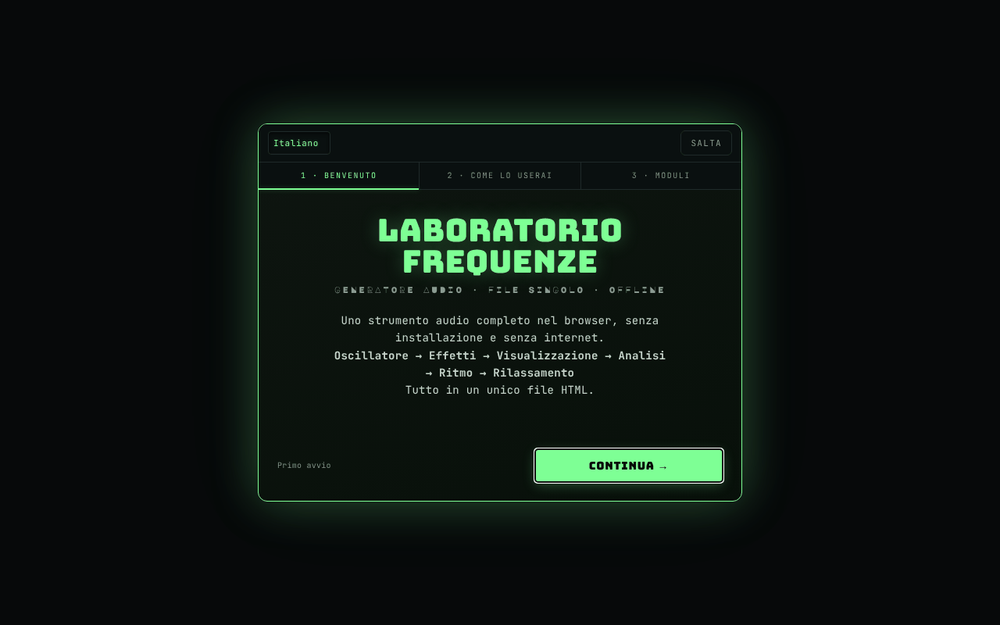

# Frequency Laboratory

[English](README.md) · [Română](README.ro.md) · [Français](README.fr.md) · **Italiano** · [Español](README.es.md) · [Português](README.pt.md) · [Deutsch](README.de.md) · [Magyar](README.hu.md)

**Versione:** 5.1.0 · **Ultimo aggiornamento:** 2026-10-27

**Stato:** stabile · **Offline:** completo

Lingue dell'interfaccia: **Română, English, Français, Italiano, Español, Português (PT), Deutsch, Magyar**

Generatore audio completo nel browser: oscillatori, binaurale, filtri, effetti, pianoforte, analizzatori e test uditivi.

**App online:** https://chiuta.github.io/FrequencyLaboratory/

## Che cos'è

Frequency Laboratory (v4.2.0 nel titolo dell'app) è un laboratorio audio in un unico file HTML, basato sulla Web Audio API. Combina generatore di toni, sintesi, effetti, sessioni programmabili, strumenti di misura con il microfono e una banca dati di frequenze (Solfeggio, Schumann, binaurali, accordature, ecc.). L'applicazione precisa che non è un trattamento medico e che le categorie di frequenze hanno carattere informativo.

## Funzioni

Le funzioni qui sotto compaiono come sezioni/controlli nell'interfaccia:

- **Generazione:** Osc A e Osc B (sinusoide, quadra, triangolare, dente di sega), modalità binaurale (Δ binaurale), hard sync, ADSR, portamento, filtri (passa-basso/passa-alto/passa-banda, notch, shelf, peaking, comb), sweep, modulazione AM/isocronica (ISO 2/6/10/40 Hz), rumore bianco/rosa/marrone.
- **Sintesi ed effetti:** accordi e arpeggiatore, sub-oscillatore e supersaw, FM, ring, auto-pan, drive/compressore/EQ a 5 bande/gate/chorus/flanger/delay/reverb, filtro di formanti vocali, matrice di modulazione LFO, player di progressioni di accordi, step sequencer a 8 passi, Karplus-Strong, sintetizzatore granulare, looper, accordature (12-TET, giusta, pitagorica, 19-TET, 31-TET, raga, gamelan, ecc.).
- **Pianoforte e MIDI:** tastiera, note scritte (es. A4), tap tempo, MIDI IN (Web MIDI, solo nei browser che lo supportano), mappature MIDI.
- **Analisi:** oscilloscopio, spettro FFT, spettrogramma, istogramma, scope di fase (Lissajous), RTA a 1/3 di ottava, THD stimato, accordatore con microfono, fonometro SPL con calibrazione, misura dell'ambiente (room sweep) con esportazione CSV.
- **Test:** identificazione dei canali, polarità, impulso/chirp, rodaggio degli altoparlanti, audiogramma interattivo (esportazione PNG), gioco «identifica la frequenza», tinnitus matcher con mascheramento notch, toni «mosquito».
- **Suoni ambientali** generati proceduralmente (pioggia, oceano, vento, fuoco, foresta).
- **Sessioni:** fasi programmabili con crossfade, modelli Meditazione / Addormentamento / Solfeggio, sleep timer con dissolvenza, registrazione WAV a 16 bit con pre-roll.
- **Dati:** preset utente, preferiti, esportazione/importazione JSON, annulla/ripeti, condivisione della configurazione tramite URL, condivisione WAV/JSON (Web Share), temi di colore (Phosphor, Amber, Blue, Mono), Wake Lock, tutorial.
- Interfaccia in 8 lingue (RO, EN, FR, IT, ES, PT, DE, HU); si usa prima la lingua salvata, poi quella del browser (altrimenti EN), e la scelta fatta con il selettore di lingua viene conservata. La guida (ELI5), le note d'uso, il tutorial, i registri delle modifiche e il catalogo delle frequenze (circa 230 voci con nomi e descrizioni) esistono in tutte e 8 le lingue, e la versione RO, in cui circa 800 testi erano solo in inglese, è ora tradotta; i nomi propri, i formati/codici e i nomi standard dei modi musicali restano invariati. Le traduzioni diverse da RO e EN sono automatiche e non sono state verificate da madrelingua.

## Guida all'uso

1. Apri la pagina e, se necessario, percorri il tutorial (`★ TUTORIAL`).
2. Imposta la frequenza in «Osc A» e la forma d'onda; tieni il volume «master» sotto il 20% all'inizio (avviso dell'app).
3. Premi `START ▶` (o Spazio); `STOP ◼` ferma; `PANIC ✕` (o `P`) ferma all'istante.
4. Per il binaurale, avvia «Osc B», attiva la «modalità binaurale» e imposta il «Δ binaurale»; usa le cuffie.
5. Esplora le sezioni della barra dei moduli (Accordi, Effetti, Pianoforte, RTA, Audiogramma, Ambient, Presets, Database, ecc.).
6. Scorciatoie: Spazio start/stop, `P` panic, `R` registrazione, `↑/↓` frequenza A ±1 Hz, `Shift+↑/↓` ±10 Hz, `1–4` forma d'onda, `[` / `]` volume master ∓5%, `S` snap alla nota, `D` drone, `?` elenco delle scorciatoie, `Esc` chiude.
7. Registrazione: `▶ START RECORDING`, poi `↓ DOWNLOAD WAV`.
8. Preset: salva con un nome, poi `↑ EXPORT JSON` per il backup e `↓ IMPORT JSON` per il ripristino (l'importazione si unisce ai preset esistenti).
9. Il microfono (SPL, accordatore, RTA con microfono, room sweep) si attiva solo su richiesta; il browser chiede il permesso.

## Privacy e rete

- **Archiviazione locale:** `localStorage`, chiavi con prefisso `frequencylaboratory.` (lingua, tema, preset, preferiti, mappature MIDI, ordine/stato dei moduli, indicatori di onboarding). La cancellazione dei dati del sito elimina i preset; usa l'esportazione JSON per il backup.
- **Rete:** l'applicazione non effettua richieste `fetch` e non carica script o font esterni. La CSP nella pagina limita `connect-src` a `'self'`. I link (Buy Me a Coffee, alexio.tf, creativecommons.org) sono collegamenti ipertestuali aperti solo al clic.
- Il microfono è usato in locale, solo dopo la concessione del permesso; l'applicazione non invia l'audio da nessuna parte.

## Avvertenza

Contenuto informativo/educativo. L'applicazione non è un dispositivo né un trattamento medico e non sostituisce il parere medico (anche per acufene, dolore o problemi di udito). Le frequenze «Solfeggio», «Schumann», i ritmi binaurali/isocronici e i preset dell'interfaccia denominati «Pain Relief» o «Peak Performance» non hanno validazione scientifica come terapia e non hanno alcun effetto medico dimostrato (i nomi dei preset sono mantenuti come denominazioni indicative; l'interfaccia mostra l'avvertenza accanto a essi, nella lingua dell'interfaccia); la pagina stessa avverte nel pannello dei preset. Usa un volume basso (sotto il 20% all'inizio), soprattutto con le cuffie; evita le frequenze alte a volume elevato. L'audiogramma non sostituisce un audiogramma medico. Le note sul test dell'udito e sulla sicurezza e le descrizioni del catalogo delle frequenze (solfeggio, onde cerebrali, Schumann ecc., che nelle fonti hanno pretese terapeutiche) sono tradotte automaticamente e richiedono la revisione di uno specialista.

## Esecuzione locale / offline

Scarica `index.html` e aprilo nel browser; non richiede internet. Il MIDI funziona solo dove esiste Web MIDI (ad es. Chrome desktop), e l'accesso al microfono richiede un contesto sicuro (HTTPS o file locale, a seconda del browser).

## Licenza

MIT — vedi il file LICENSE

## Audit

2026-10-11 (round 3): le etichette aggiunte dall'audit e l'avvertenza sono tradotte RO/EN (richiedono revisione madrelingua); avvertenza «nessun effetto medico dimostrato» accanto ai preset Pain Relief / Peak Performance / Solfeggio.

2026-10-10: verificato (nessuna richiesta di rete nel codice, CSP `connect-src 'self'`); aggiunti nomi accessibili per i controlli, contrasto, avviso nel piè di pagina.

## Autore

Alexio — Alexandru-Ionuț Chiuță, contatto: alexio@trom.tf

## Riepilogo

Frequency Laboratory è un toolkit Web Audio in un unico file: oscillatori e battimenti binaurali, filtri ed effetti, pianoforte/MIDI, sequencer, analizzatori (FFT, RTA, scope di fase), misura SPL e dell'ambiente con il microfono, test uditivi, suoni ambientali, sessioni programmabili, registrazione WAV e una banca dati di frequenze. Interfaccia in 8 lingue (RO, EN, FR, IT, ES, PT, DE, HU). Lo stato è conservato in localStorage (chiavi `frequencylaboratory.`); l'applicazione non effettua richieste di rete (CSP `connect-src 'self'`). Non è un dispositivo medico.

## Protezione dell’udito e limitatore di volume (5.1.0)

All’avvio compare un avviso con conferma («Ho capito — attiva il suono»): fino ad allora l’uscita audio è muta. È integrato un **limitatore di volume** (tetto per tutto il suono verso altoparlanti/cuffie, test dell’udito compreso): −6 dB predefinito, regolabile da −30 dB a 0 dB dal badge «LIMITE … dB» nell’intestazione; il limite è salvato in `localStorage` (`frequencylaboratory.volcap`), la conferma solo per la sessione. Il volume «Master» resta entro il limite; i file registrati (WAV) non sono interessati. Non è un dispositivo medico: inizia con il volume del dispositivo al minimo.

## Vedi anche: FrequencyLaboratory

**FrequencyLaboratory** (questa app) e **Frequency Laboratory (generator-frecvente)** condividono la base di codice e si sovrappongono molto. FrequencyLaboratory è la versione più recente e completa; generator-frecvente mantiene l’interfaccia classica a pannello unico e ha la libreria di scene. Le due app NON sono state unite; hanno chiavi di archiviazione separate e possono scambiarsi la configurazione tramite un link (`#state=`). generator-frecvente: https://chiuta.github.io/generator-frecvente/

## Cronologia / Changelog

- **5.1.0 — 2026-10-27:** avviso di protezione dell’udito con conferma prima del primo suono + limitatore di volume (tetto, −6 dB predefinito, regolabile); nota «vedi anche» FrequencyLaboratory; righe Stato/Offline; CHANGELOG.md (precedente: v5.0.0).
- **4.3.9 — 2026-10-22:** Bersagli touch: i badge «?» ELI5 raggiungono 24×24 px (44 px su puntatore grossolano). Nuovo audit a 360 e 1366 px (stato iniziale, sezioni espanse, pannelli nascosti): non restano bersagli sotto 24 px né testo sotto 12 px.

### 4.3.13 — 2026-10-23

- Fix: user presets with wrongly typed fields (e.g. string `freqA`, missing `beatRate`) no longer break the presets panel; CSP hash recalculated.

### 4.3.12 — 2026-10-23

- Fix: startup no longer fails when `module_order_v1` or `midi_mappings` in localStorage are corrupt (object/`null`/number); CSP hash recalculated.

### 4.3.11 — 2026-10-23

- Dialoghi: le finestre native `alert`/`confirm`/`prompt` sono state sostituite da dialoghi `FFF.dialog` accessibili e tradotti (tastiera, focus trap, Esc), con lo stesso comportamento (fff-kit 1.2.0).

### 4.3.8 — 2026-10-22

fff-kit 1.1.4: aree tattili e testo minimo. Aree tattili/testo corretti nell’app.

### 4.3.7 — 2026-10-22

fff-kit 1.1.2: PBKDF2 a 600.000 iterazioni, protezione anti-clickjacking.

### 4.3.6 — 2026-10-22

chiavi `localStorage` proprie con il prefisso `frequencylaboratory.`, migrate automaticamente dalle vecchie chiavi `lab_frecv_` (che andavano in collisione con Generator de frecvențe sulla stessa origine); i preset importati vengono convalidati (solo campi noti, tipi corretti, numeri finiti: un valore `1e309` non rompe più i parametri audio); service worker e manifest reali (avvio offline, installabile); numero di versione rimosso dal titolo della pagina; focus da tastiera visibile su ogni controllo. rifiniture per mobile e accessibilità: testo di almeno 12 px e aree tattili di almeno 24 px.

### 4.3.5 — 2026-10-22
- Correzione di traduzione: quattro testi di aiuto ancora a metà in inglese nell’interfaccia rumena sono ora interamente in rumeno; le etichette di stato di sleep-fade, matrice, clock MIDI, buffer dello spettrogramma e contesto audio seguono ora la lingua dell’interfaccia.

### 4.3.4 — 2026-10-22
- Correzione di traduzione: i nomi accessibili (Share URL, Pluck, Moduli, pulsanti «spiegazione semplice») seguono ora la lingua dell'interfaccia invece di mescolare il rumeno; il titolo della pagina segue la lingua; sette testi di aiuto in rumeno (e una nota della drum machine) sono stati riscritti correttamente invece di mescolare inglese e rumeno.

### 4.3.3 — 2026-10-22
- Corretto: il nome accessibile rumeno del pulsante Wake lock ora inizia con il testo visibile («Wake lock – menține ecranul activ»), come richiesto da WCAG Label in Name.

### 4.3.2 — 2026-10-19
- Gli script di accessibilità dell'app sono di nuovo presenti: nomi accessibili automatici per i controlli senza etichetta, font di riserva per le lettere Ă ă Ș ș Ț ț nei font di visualizzazione e regola del testo visibile nel nome accessibile (WCAG 2.5.3). Erano stati rimossi per errore in una pulizia precedente e sono stati ripristinati, con i suffissi dei nomi generati in 8 lingue. Problema minore noto: nell'interfaccia RO il nome accessibile del pulsante «Wake lock» non inizia con il suo testo visibile.

### 4.3.1 — 2026-10-19
- Tutti i testi lunghi (guida ELI5, note d'uso, tutorial, registri delle modifiche, catalogo delle frequenze) in 8 lingue; l'interfaccia in rumeno, che aveva ancora circa 800 testi solo in inglese, è tradotta.

### 4.2.1 — 2026-10-19
- Correzione: durante il caricamento da `#state=<base64>`, i parametri aggiuntivi presenti nell'indirizzo (ad es. `&from=generator-frecvente`) non compromettono più la decodifica dello stato.

### 4.2.0 — 2026-10-14
- Copia di riserva ed etichettatura dei dati (fff-kit).

### 12 ottobre 2026 (v4.1.3)
- 4.1.3 — 2026-10-12: la versione e la data dell'ultimo aggiornamento sono mostrate nell'app

### 11 ottobre 2026
- Prima visita: la lingua predefinita segue quella del browser (rumeno → RO, altrimenti EN) invece di essere sempre RO; prima i visitatori con browser in inglese vedevano un'interfaccia mista RO/EN.
- Eliminate le tre notifiche (toast) al caricamento (portamento, micro-accordatura, «v4.1.2 caricato · MIDI»), che si sovrapponevano all'intestazione; il messaggio sul MIDI compare quando si usa il MIDI. Scompare anche la parola francese «prêt» da una di esse.
- La pillola delle donazioni segue la lingua dell'interfaccia (RO/EN), comprese le etichette ARIA.
- v4.1.2: avviso di volume (oltre il 60%, `role=status`, RO/EN) accanto al volume master; scorciatoie `[` / `]` per il volume; CSP su hash (senza `'unsafe-inline'` in `script-src`, `blob:` mantenuto per il worklet/la registrazione). Testato offline: 0 errori/violazioni CSP, 0 overflow orizzontale, axe 0.
- Versione unificata v4.1.2 (titolo, intestazione, manifest, piè di pagina; prima il titolo diceva v4.0 e il piè di pagina v4.1).
- La guida di benvenuto (primo avvio) ha ora i pulsanti RO/EN e «Salta» (più il tasto Esc), è una finestra di dialogo accessibile ed è tradotta completamente in inglese; i moduli/profili sono tradotti in fase di visualizzazione. Sugli schermi bassi non taglia più la parte superiore.
- I font di visualizzazione incorporati non contengono Ă/Ș/Ț: gli elementi interessati passano al font di testo (classe `dia-fb`), quindi il titolo non mescola più i glifi (ad es. «FRECVENȚE», «CONTINUĂ»).
- Axe: 0 violazioni (contenuto in `<main>`, 18 campi con `aria-label`, titoli h2 in «Usage notes», `aside` per le donazioni, contenitore delle notifiche come regione). Corretto «uppended» → «suspended» nell'indicatore CTX.
