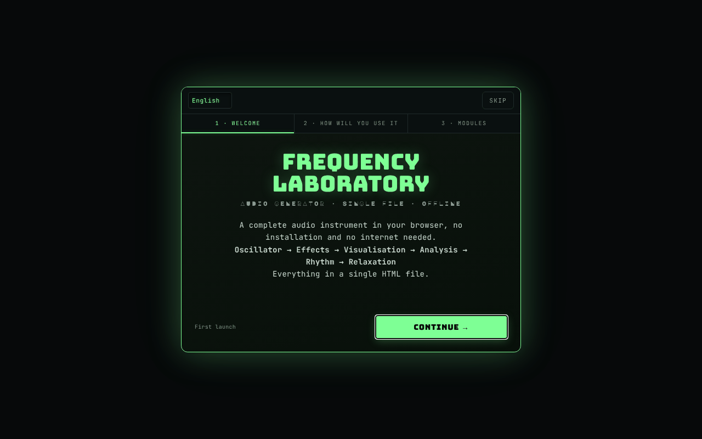

# Frequency Laboratory

**English** · [Română](README.ro.md) · [Français](README.fr.md) · [Italiano](README.it.md) · [Español](README.es.md) · [Português](README.pt.md) · [Deutsch](README.de.md) · [Magyar](README.hu.md)

**Version:** 4.3.7 · **Last updated:** 2026-10-22

Interface languages: **Română, English, Français, Italiano, Español, Português (PT), Deutsch, Magyar**

A complete audio generator in the browser: oscillators, binaural, filters, effects, piano, analyzers and hearing tests.

**Live app:** https://chiuta.github.io/FrequencyLaboratory/

## What it is

Frequency Laboratory (v4.2.0 in the app's title) is an audio laboratory in a single HTML file, based on the Web Audio API. It combines a tone generator, synthesis, effects, programmable sessions, microphone-based measurement tools and a database of frequencies (Solfeggio, Schumann, binaural, tunings, etc.). The app states that it is not a medical treatment and that the frequency categories are informational.

## Features

The features below appear as sections/controls in the interface:

- **Generation:** Osc A and Osc B (sine, square, triangle, sawtooth), binaural mode (binaural Δ), hard sync, ADSR, portamento, filters (low/high/band-pass, notch, shelf, peaking, comb), sweep, AM/isochronic modulation (ISO 2/6/10/40 Hz), white/pink/brown noise.
- **Synthesis and effects:** chords and arpeggiator, sub-oscillator and supersaw, FM, ring, auto-pan, drive/compressor/5-band EQ/gate/chorus/flanger/delay/reverb, vocal formant filter, LFO modulation matrix, chord progression player, 8-step step sequencer, Karplus-Strong, granular synthesizer, looper, tunings (12-TET, just, Pythagorean, 19-TET, 31-TET, raga, gamelan, etc.).
- **Piano and MIDI:** keyboard, typed notes (e.g. A4), tap tempo, MIDI IN (Web MIDI, only in browsers that support it), MIDI mappings.
- **Analysis:** oscilloscope, FFT spectrum, spectrogram, histogram, phase scope (Lissajous), 1/3-octave RTA, estimated THD, microphone tuner, SPL meter with calibration, room measurement (room sweep) with CSV export.
- **Tests:** channel identification, polarity, impulse/chirp, speaker break-in, interactive audiogram (PNG export), "identify the frequency" game, tinnitus matcher with notch masking, "mosquito" tones.
- **Ambient sounds** generated procedurally (rain, ocean, wind, fire, forest).
- **Sessions:** programmable stages with crossfade, Meditation / Sleep / Solfeggio templates, sleep timer with fade, 16-bit WAV recording with pre-roll.
- **Data:** user presets, favorites, JSON export/import, undo/redo, configuration sharing via URL, WAV/JSON sharing (Web Share), colour themes (Phosphor, Amber, Blue, Mono), Wake Lock, tutorial.
- Interface in 8 languages (RO, EN, FR, IT, ES, PT, DE, HU); the saved language is used first, then the browser language (otherwise EN), and the choice made with the language selector is kept. The help (ELI5), usage notes, tutorial, changelogs and the frequency catalogue (about 230 entries with names and descriptions) exist in all 8 languages, and the Romanian version, in which about 800 texts used to be English only, is now translated; proper names, formats/codes and the standard names of the musical modes are left as they are. The translations other than RO and EN are automatic and have not been verified by native speakers.

## User guide

1. Open the page and, if needed, go through the tutorial (`★ TUTORIAL`).
2. Set the frequency in "Osc A" and the waveform; keep the "master" volume below 20% at first (warning from the app).
3. Press `START ▶` (or Space); `STOP ◼` stops; `PANIC ✕` (or `P`) stops instantly.
4. For binaural, start "Osc B", enable "binaural mode" and set "binaural Δ"; use headphones.
5. Explore the sections in the module bar (Chords, Effects, Piano, RTA, Audiogram, Ambient, Presets, Database, etc.).
6. Shortcuts: Space start/stop, `P` panic, `R` record, `↑/↓` frequency A ±1 Hz, `Shift+↑/↓` ±10 Hz, `1–4` waveform, `[` / `]` master volume ∓5%, `S` snap to note, `D` drone, `?` list of shortcuts, `Esc` closes.
7. Recording: `▶ START RECORDING`, then `↓ DOWNLOAD WAV`.
8. Presets: save with a name, then `↑ EXPORT JSON` for backup and `↓ IMPORT JSON` for restoring (the import is merged with the existing presets).
9. The microphone (SPL, tuner, microphone RTA, room sweep) is activated only on request; the browser asks for permission.

## Privacy and network

- **Local storage:** `localStorage`, keys with the prefix `frequencylaboratory.` (language, theme, presets, favorites, MIDI mappings, module order/state, onboarding markers). Clearing the site data deletes the presets; use the JSON export for backup.
- **Network:** the app makes no `fetch` requests and loads no external scripts or fonts. The CSP in the page limits `connect-src` to `'self'`. The links (Buy Me a Coffee, alexio.tf, creativecommons.org) are hyperlinks opened only on click.
- The microphone is used locally, only after permission is granted; the app does not send the audio anywhere.

## Disclaimer

Informational/educational content. The app is not a medical device or treatment and does not replace medical advice (including for tinnitus, pain or hearing problems). The "Solfeggio", "Schumann" frequencies, the binaural/isochronic rhythms and the presets in the interface named "Pain Relief" or "Peak Performance" have no scientific validation as therapy and no proven medical effect (the preset names are kept as indicative labels; the interface shows the disclaimer next to them, in the interface language); the page itself warns in the presets panel. Use a low volume (below 20% at first), especially with headphones; avoid high frequencies at high volume. The audiogram does not replace a medical audiogram. The hearing-test and safety notes and the descriptions in the frequency catalogue (solfeggio, brainwave, Schumann etc., which carry therapeutic claims in the sources) are translated automatically and need review by a specialist.

## Running locally / offline

Download `index.html` and open it in a browser; it requires no internet. MIDI works only where Web MIDI exists (e.g. desktop Chrome), and microphone access requires a secure context (HTTPS or a local file, depending on the browser).

## License

MIT — see the LICENSE file

## Audit

2026-10-11 (round 3): the labels added by the audit and the disclaimer are translated RO/EN (they need native review); disclaimer "no proven medical effect" next to the Pain Relief / Peak Performance / Solfeggio presets.

2026-10-10: verified (no network requests in the code, CSP `connect-src 'self'`); accessible names added for controls, contrast, warning in the footer.

## Author

Alexio — Alexandru-Ionuț Chiuță, contact: alexio@trom.tf

## Summary

Frequency Laboratory is a single-file Web Audio toolkit: oscillators and binaural beats, filters and effects, piano/MIDI, sequencer, analyzers (FFT, RTA, phase scope), microphone-based SPL and room measurement, hearing tests, ambient sounds, programmable sessions, WAV recording and a frequency database. UI in 8 languages (RO, EN, FR, IT, ES, PT, DE, HU). State is kept in localStorage (`frequencylaboratory.` keys); the app makes no network requests (CSP `connect-src 'self'`). It is not a medical device.

## History / Changelog

### 4.3.7 — 2026-10-22

fff-kit 1.1.2: PBKDF2 with 600,000 iterations, anti-clickjacking protection.

### 4.3.6 — 2026-10-22

own `localStorage` keys with the `frequencylaboratory.` prefix, migrated automatically from the old `lab_frecv_` keys (which collided with Generator de frecvențe on the same origin); imported presets are validated (only known fields, correct types, finite numbers: a `1e309` value no longer breaks the audio parameters); real service worker and manifest (offline start, installable); version number removed from the page title; visible keyboard focus on every control. mobile and accessibility polish: text at least 12 px and touch targets at least 24 px.

### 4.3.5 — 2026-10-22
- Translation fix: four help texts that were still half-English in the Romanian interface are now fully Romanian; the sleep-fade, matrix, MIDI-clock, spectrogram-buffer and audio-context status labels now follow the interface language.

### 4.3.4 — 2026-10-22
- Translation fix: accessible names (Share URL, Pluck, Modules, “simple explanation” buttons) now follow the interface language instead of mixing in Romanian; the page title follows the language; seven help texts in Romanian (and a drum-machine note) were rewritten properly instead of mixing English and Romanian.

### 4.3.3 — 2026-10-22
- Fixed: the Romanian accessible name of the Wake lock button now starts with the visible text ("Wake lock – menține ecranul activ"), satisfying WCAG Label in Name.

### 4.3.2 — 2026-10-19
- The accessibility scripts of the app are present again: automatic accessible names for controls without a label, the fallback font for the letters Ă ă Ș ș Ț ț in the display fonts, and the visible-text-in-the-accessible-name rule (WCAG 2.5.3). They had been removed by mistake in an earlier cleanup and were restored, with the suffixes of the generated names in 8 languages. Known minor issue: in the RO interface the accessible name of the "Wake lock" button does not start with its visible text.

### 4.3.1 — 2026-10-19
- All the long texts (ELI5 help, usage notes, tutorial, changelogs, frequency catalogue) in 8 languages; the Romanian interface, which still had about 800 English-only texts, is translated.

### 4.2.1 — 2026-10-19
- Fix: when loading from `#state=<base64>`, extra parameters in the address (e.g. `&from=generator-frecvente`) no longer break the decoding of the state.

### 4.2.0 — 2026-10-14
- Backup and data labelling (fff-kit).

### 12 October 2026 (v4.1.3)
- 4.1.3 — 2026-10-12: the version and the date of the last update are displayed in the app

### 11 October 2026
- First visit: the default language follows the browser language (Romanian → RO, otherwise EN) instead of always being RO; previously visitors with an English browser saw a mixed RO/EN interface.
- Removed the three notifications (toasts) at load (portamento, micro-tuning, "v4.1.2 loaded · MIDI"), which overlapped the header; the MIDI message appears when MIDI is used. The French word "prêt" in one of them also disappears.
- The donation pill follows the interface language (RO/EN), including the ARIA labels.
- v4.1.2: volume warning (above 60%, `role=status`, RO/EN) next to the master volume; `[` / `]` shortcuts for volume; CSP on hash (no `'unsafe-inline'` in `script-src`, `blob:` kept for the worklet/recording). Tested offline: 0 CSP errors/violations, 0 horizontal overflow, axe 0.
- Unified version v4.1.2 (title, header, manifest, footer; previously the title said v4.0 and the footer v4.1).
- The welcome guide (first run) now has RO/EN buttons and "Skip" (plus the Esc key), is an accessible dialog and is fully translated into English; the modules/profiles are translated on display. On short screens it no longer cuts off the top.
- The embedded display fonts do not contain Ă/Ș/Ț: the affected elements switch to the text font (class `dia-fb`), so the title no longer mixes glyphs (e.g. "FRECVENȚE", "CONTINUĂ").
- Axe: 0 violations (content in `<main>`, 18 fields with `aria-label`, h2 headings in "Usage notes", `aside` for donations, the notification container as a region). Corrected "uppended" → "suspended" in the CTX indicator.
