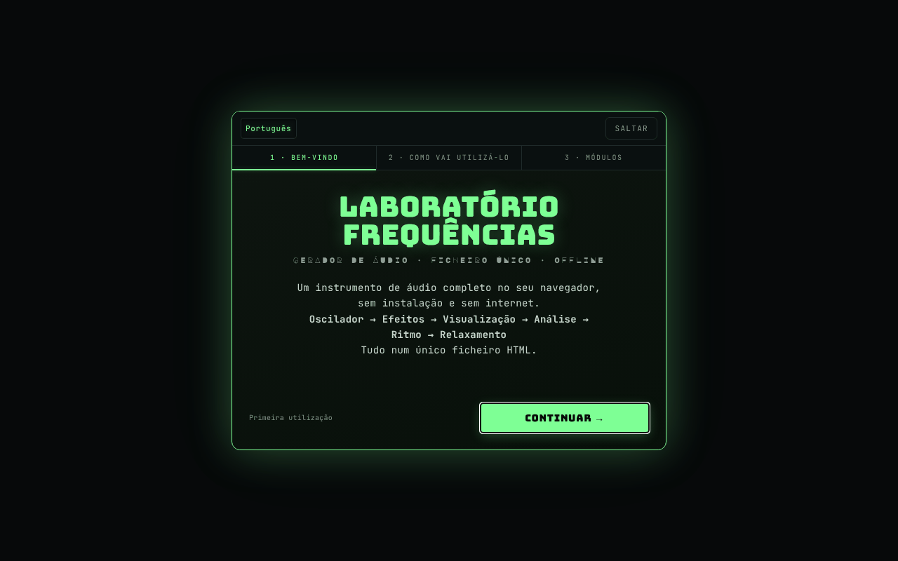

# Frequency Laboratory

[English](README.md) · [Română](README.ro.md) · [Français](README.fr.md) · [Italiano](README.it.md) · [Español](README.es.md) · **Português** · [Deutsch](README.de.md) · [Magyar](README.hu.md)

**Versão:** 4.3.0 · **Última atualização:** 2026-10-19

Idiomas da interface: **Română, English, Français, Italiano, Español, Português (PT), Deutsch, Magyar**

Gerador de áudio completo no navegador: osciladores, binaural, filtros, efeitos, piano, analisadores e testes auditivos.

**Aplicação online:** https://chiuta.github.io/FrequencyLaboratory/

## O que é

O Frequency Laboratory (v4.2.0 no título da aplicação) é um laboratório de áudio num único ficheiro HTML, baseado na Web Audio API. Combina gerador de tons, síntese, efeitos, sessões programáveis, ferramentas de medição com o microfone e uma base de dados de frequências (Solfeggio, Schumann, binaurais, afinações, etc.). A aplicação esclarece que não é um tratamento médico e que as categorias de frequências são meramente informativas.

## Funcionalidades

As funcionalidades abaixo surgem como secções/controlos na interface:

- **Geração:** Osc A e Osc B (sinusoidal, quadrada, triangular, dente de serra), modo binaural (Δ binaural), hard sync, ADSR, portamento, filtros (passa-baixo/passa-alto/passa-banda, notch, shelf, peaking, comb), sweep, modulação AM/isocrónica (ISO 2/6/10/40 Hz), ruído branco/rosa/castanho.
- **Síntese e efeitos:** acordes e arpejador, suboscilador e supersaw, FM, ring, auto-pan, drive/compressor/equalizador de 5 bandas/gate/chorus/flanger/delay/reverb, filtro de formantes vocais, matriz de modulação LFO, reprodutor de progressões de acordes, sequenciador por passos de 8 passos, Karplus-Strong, sintetizador granular, looper, afinações (12-TET, justa, pitagórica, 19-TET, 31-TET, raga, gamelão, etc.).
- **Piano e MIDI:** teclado, notas escritas (p. ex. A4), tap tempo, MIDI IN (Web MIDI, apenas em navegadores que o suportem), mapeamentos MIDI.
- **Análise:** osciloscópio, espectro FFT, espectrograma, histograma, osciloscópio de fase (Lissajous), RTA em terços de oitava, THD estimada, afinador com microfone, decibelímetro SPL com calibração, medição de sala (room sweep) com exportação CSV.
- **Testes:** identificação de canais, polaridade, impulso/chirp, rodagem de colunas, audiograma interativo (exportação PNG), jogo «identifique a frequência», tinnitus matcher com mascaramento notch, tons «mosquito».
- **Sons ambiente** gerados proceduralmente (chuva, oceano, vento, fogo, floresta).
- **Sessões:** etapas programáveis com crossfade, modelos de Meditação / Adormecer / Solfeggio, temporizador de sono com fade, gravação WAV de 16 bits com pre-roll.
- **Dados:** predefinições do utilizador, favoritos, exportação/importação JSON, anular/refazer, partilha da configuração por URL, partilha WAV/JSON (Web Share), temas de cor (Phosphor, Amber, Blue, Mono), Wake Lock, tutorial.
- Interface em 8 idiomas (RO, EN, FR, IT, ES, PT, DE, HU); usa-se primeiro o idioma guardado, depois o do navegador (caso contrário EN), e a escolha feita com o seletor de idioma é conservada. Atenção: na versão RO muitas etiquetas técnicas permanecem em inglês (waveform, reverb, cutoff, etc.).

## Manual de utilização

1. Abra a página e, se necessário, percorra o tutorial (`★ TUTORIAL`).
2. Defina a frequência em «Osc A» e a forma de onda; mantenha o volume «master» abaixo de 20% no início (aviso da aplicação).
3. Prima `START ▶` (ou Espaço); `STOP ◼` pára; `PANIC ✕` (ou `P`) pára instantaneamente.
4. Para binaural, inicie o «Osc B», ative o «modo binaural» e defina o «Δ binaural»; use auscultadores.
5. Explore as secções da barra de módulos (Acordes, Efeitos, Piano, RTA, Audiograma, Ambient, Presets, Database, etc.).
6. Atalhos: Espaço start/stop, `P` panic, `R` gravação, `↑/↓` frequência A ±1 Hz, `Shift+↑/↓` ±10 Hz, `1–4` forma de onda, `[` / `]` volume master ∓5%, `S` ajuste à nota, `D` drone, `?` lista de atalhos, `Esc` fecha.
7. Gravação: `▶ START RECORDING`, depois `↓ DOWNLOAD WAV`.
8. Predefinições: guarde com um nome, depois `↑ EXPORT JSON` para cópia de segurança e `↓ IMPORT JSON` para restauro (a importação funde-se com as predefinições existentes).
9. O microfone (SPL, afinador, RTA com microfone, room sweep) só é ativado a pedido; o navegador pede permissão.

## Privacidade e rede

- **Armazenamento local:** `localStorage`, chaves com o prefixo `lab_frecv_` (idioma, tema, predefinições, favoritos, mapeamentos MIDI, ordem/estado dos módulos, marcas de onboarding). Apagar os dados do sítio elimina as predefinições; use a exportação JSON como cópia de segurança.
- **Rede:** a aplicação não faz pedidos `fetch` e não carrega scripts nem tipos de letra externos. A CSP da página limita `connect-src` a `'self'`. As ligações (Buy Me a Coffee, alexio.tf, creativecommons.org) são hiperligações abertas apenas ao clicar.
- O microfone é usado localmente, apenas após a concessão da permissão; a aplicação não envia o áudio para lado nenhum.

## Aviso

Conteúdo informativo/educativo. A aplicação não é um dispositivo nem um tratamento médico e não substitui o aconselhamento médico (incluindo em caso de acufenos, dor ou problemas de audição). As frequências «Solfeggio», «Schumann», os ritmos binaurais/isocrónicos e as predefinições da interface denominadas «Pain Relief» ou «Peak Performance» não têm validação científica como terapia nem efeito médico comprovado (os nomes das predefinições são mantidos como designações indicativas; a interface apresenta o aviso junto a elas, em RO e EN); a própria página avisa no painel de predefinições. Use um volume baixo (abaixo de 20% no início), sobretudo com auscultadores; evite frequências agudas a volume elevado. O audiograma não substitui uma audiometria médica.

## Execução local / offline

Transfira `index.html` e abra-o no navegador; não requer internet. O MIDI só funciona onde existe Web MIDI (p. ex. Chrome de computador), e o acesso ao microfone requer um contexto seguro (HTTPS ou ficheiro local, consoante o navegador).

## Licença

MIT — ver o ficheiro LICENSE

## Auditoria

2026-10-11 (ronda 3): as etiquetas acrescentadas pela auditoria e o aviso estão traduzidos para RO/EN (necessitam de revisão nativa); aviso «sem efeito médico comprovado» junto às predefinições Pain Relief / Peak Performance / Solfeggio.

2026-10-10: verificado (sem pedidos de rede no código, CSP `connect-src 'self'`); acrescentados nomes acessíveis para os controlos, contraste, aviso no rodapé.

## Autor

Alexio — Alexandru-Ionuț Chiuță, contacto: alexio@trom.tf

## Resumo

O Frequency Laboratory é um conjunto de ferramentas Web Audio num único ficheiro: osciladores e batimentos binaurais, filtros e efeitos, piano/MIDI, sequenciador, analisadores (FFT, RTA, osciloscópio de fase), medição de SPL e de sala com microfone, testes auditivos, sons ambiente, sessões programáveis, gravação WAV e uma base de dados de frequências. Interface em romeno/inglês. O estado é guardado em localStorage (chaves `lab_frecv_`); a aplicação não faz pedidos de rede (CSP `connect-src 'self'`). Não é um dispositivo médico.

## Histórico / Changelog

### 4.2.1 — 2026-10-19
- Correção: ao carregar a partir de `#state=<base64>`, os parâmetros adicionais do endereço (p. ex. `&from=generator-frecvente`) deixam de estragar a descodificação do estado.

### 4.2.0 — 2026-10-14
- Cópia de segurança e etiquetagem de dados (fff-kit).

### 12 de outubro de 2026 (v4.1.3)
- 4.1.3 — 2026-10-12: a versão e a data da última atualização são apresentadas na aplicação

### 11 de outubro de 2026
- Primeira visita: o idioma predefinido segue o do navegador (romeno → RO, caso contrário EN) em vez de ser sempre RO; antes, os visitantes com navegador em inglês viam uma interface misturada RO/EN.
- Eliminadas as três notificações (toasts) no carregamento (portamento, microafinação, «v4.1.2 carregado · MIDI»), que se sobrepunham ao cabeçalho; a mensagem sobre MIDI aparece quando se usa MIDI. Desaparece também a palavra francesa «prêt» de uma delas.
- A pílula de donativos segue o idioma da interface (RO/EN), incluindo as etiquetas ARIA.
- v4.1.2: aviso de volume (acima de 60%, `role=status`, RO/EN) junto ao volume master; atalhos `[` / `]` para o volume; CSP por hash (sem `'unsafe-inline'` em `script-src`, `blob:` mantido para o worklet/gravação). Testado offline: 0 erros/violações de CSP, 0 transbordo horizontal, axe 0.
- Versão unificada v4.1.2 (título, cabeçalho, manifesto, rodapé; antes o título dizia v4.0 e o rodapé v4.1).
- O guia de boas-vindas (primeira execução) tem agora botões RO/EN e «Saltar» (mais a tecla Esc), é uma caixa de diálogo acessível e está totalmente traduzido para inglês; os módulos/perfis são traduzidos na apresentação. Em ecrãs baixos já não corta a parte superior.
- Os tipos de letra de apresentação incorporados não contêm Ă/Ș/Ț: os elementos afetados passam para o tipo de letra de texto (classe `dia-fb`), pelo que o título deixa de misturar glifos (p. ex. «FRECVENȚE», «CONTINUĂ»).
- Axe: 0 violações (conteúdo em `<main>`, 18 campos com `aria-label`, títulos h2 em «Usage notes», `aside` para donativos, contentor de notificações como região). Corrigido «uppended» → «suspended» no indicador CTX.
