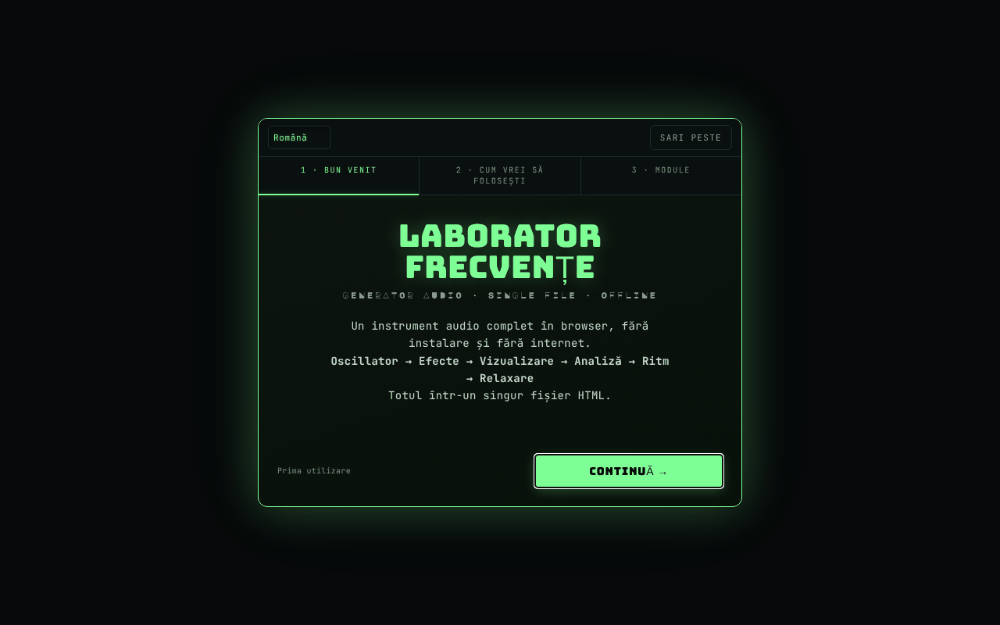

# Frequency Laboratory

[English](README.md) · **Română** · [Français](README.fr.md) · [Italiano](README.it.md) · [Español](README.es.md) · [Português](README.pt.md) · [Deutsch](README.de.md) · [Magyar](README.hu.md)

**Versiune:** 4.3.11 · **Ultima actualizare:** 2026-10-23

Limbile interfeței: **Română, English, Français, Italiano, Español, Português (PT), Deutsch, Magyar**

Generator audio complet în browser: oscilatoare, binaural, filtre, efecte, pian, analizoare și teste auditive.

**Live:** https://chiuta.github.io/FrequencyLaboratory/

## Ce este

Frequency Laboratory (v4.2.0 în titlul aplicației) este un laborator audio dintr-un singur fișier HTML, bazat pe Web Audio API. Combină generator de tonuri, sinteză, efecte, sesiuni programabile, instrumente de măsurare cu microfonul și o bază de date de frecvențe (Solfeggio, Schumann, binaurale, acordaje etc.). Aplicația precizează că nu este tratament medical și că categoriile de frecvențe sunt informative.

## Funcții

Funcțiile de mai jos apar ca secțiuni/controale în interfață:

- **Generare:** Osc A și Osc B (sinus, pătrat, triunghi, fierăstrău), mod binaural (Δ binaural), hard sync, ADSR, portamento, filtre (low/high/band-pass, notch, shelf, peaking, comb), sweep, modulare AM/izocronică (ISO 2/6/10/40 Hz), zgomot alb/roz/brun.
- **Sinteză și efecte:** acorduri și arpegiator, sub-oscilator și supersaw, FM, ring, auto-pan, drive/compresor/EQ 5 benzi/gate/chorus/flanger/delay/reverb, filtru de formanți vocale, matrice de modulare LFO, player de progresii de acorduri, step sequencer cu 8 pași, Karplus-Strong, sintetizator granular, looper, acordaje (ET-12, just, pitagoreic, 19-TET, 31-TET, raga, gamelan ș.a.).
- **Pian și MIDI:** claviatură, note scrise (ex. A4), tap tempo, MIDI IN (Web MIDI, doar în browsere care îl suportă), mapări MIDI.
- **Analiză:** osciloscop, spectru FFT, spectrogramă, histogramă, scop de fază (Lissajous), RTA pe 1/3 de octavă, THD estimat, tuner cu microfon, contor SPL cu calibrare, măsurare de cameră (room sweep) cu export CSV.
- **Teste:** identificare canale, polaritate, impuls/chirp, break-in pentru boxe, audiogramă interactivă (export PNG), joc „identifică frecvența”, tinnitus matcher cu mascare notch, tonuri „mosquito”.
- **Sunete ambientale** generate procedural (ploaie, ocean, vânt, foc, pădure).
- **Sesiuni:** etape programabile cu crossfade, șabloane Meditation / Adormire / Solfeggio, sleep timer cu fade, înregistrare WAV pe 16 biți cu pre-roll.
- **Date:** presetări utilizator, favorite, export/import JSON, undo/redo, partajare configurație prin URL, partajare WAV/JSON (Web Share), teme de culoare (Phosphor, Amber, Blue, Mono), Wake Lock, tutorial.
- Interfață în 8 limbi (RO, EN, FR, IT, ES, PT, DE, HU); se folosește mai întâi limba salvată, apoi limba browserului (altfel EN), iar alegerea făcută cu selectorul de limbă se păstrează. Ajutorul (ELI5), notele de utilizare, tutorialul, jurnalele de modificări și catalogul de frecvențe (circa 230 de intrări cu nume și descrieri) există în toate cele 8 limbi, iar varianta RO, în care circa 800 de texte erau doar în engleză, este acum tradusă; numele proprii, formatele/codurile și denumirile standard ale modurilor muzicale rămân ca atare. Traducerile în afară de RO și EN sunt automate și neverificate de vorbitori nativi.

## Manual de utilizare

1. Deschide pagina și, la nevoie, parcurge tutorialul (`★ TUTORIAL`).
2. Setează frecvența în „Osc A” și forma de undă; ține volumul „master” sub 20% la început (avertisment din aplicație).
3. Apasă `START ▶` (sau Spațiu); `STOP ◼` oprește; `PANIC ✕` (sau `P`) oprește instant.
4. Pentru binaural, pornește „Osc B”, activează „mod binaural” și setează „Δ binaural”; folosește căști.
5. Explorează secțiunile din bara de module (Acorduri, Efecte, Pian, RTA, Audiogram, Ambient, Presets, Database ș.a.).
6. Scurtături: Spațiu start/stop, `P` panic, `R` înregistrare, `↑/↓` frecvență A ±1 Hz, `Shift+↑/↓` ±10 Hz, `1–4` formă de undă, `[` / `]` volum master ∓5%, `S` snap la notă, `D` drone, `?` lista de scurtături, `Esc` închide.
7. Înregistrare: `▶ START RECORDING`, apoi `↓ DOWNLOAD WAV`.
8. Presetări: salvează cu nume, apoi `↑ EXPORT JSON` pentru backup și `↓ IMPORT JSON` pentru restaurare (importul se îmbină cu presetările existente).
9. Microfonul (SPL, tuner, RTA pe microfon, room sweep) se activează doar la cerere; browserul cere permisiune.

## Confidențialitate și rețea

- **Stocare locală:** `localStorage`, chei cu prefixul `frequencylaboratory.` (limbă, temă, presetări, favorite, mapări MIDI, ordinea/starea modulelor, marcaje de onboarding). Ștergerea datelor site-ului șterge presetările; folosește exportul JSON pentru backup.
- **Rețea:** aplicația nu face cereri `fetch` și nu încarcă scripturi sau fonturi externe. Politica CSP din pagină limitează `connect-src` la `'self'`. Linkurile (Buy Me a Coffee, alexio.tf, creativecommons.org) sunt hiperlegături deschise doar la click.
- Microfonul este folosit local, doar după acordarea permisiunii; audio-ul nu este trimis nicăieri de aplicație.

## Avertisment

Conținut informativ/educațional. Aplicația nu este dispozitiv sau tratament medical și nu înlocuiește sfatul medical (inclusiv pentru tinnitus, durere sau probleme de auz). Frecvențele „Solfeggio", „Schumann", ritmurile binaurale/izocronice și presetările din interfață denumite „Pain Relief" sau „Peak Performance" nu au validare științifică ca terapie și nu au efect medical dovedit (numele presetărilor sunt păstrate ca denumiri orientative; interfața afișează disclaimerul lângă ele, în limba interfeței); pagina însăși avertizează în panoul de presetări. Folosește volum redus (sub 20% la început), mai ales cu căști; evită frecvențe înalte la volum mare. Audiograma nu înlocuiește un audiogram medical. Notele despre testul auditiv și siguranță și descrierile din catalogul de frecvențe (solfeggio, unde cerebrale, Schumann etc., care poartă în surse pretenții terapeutice) sunt traduse automat și necesită revizuire de către un specialist.

## Rulare locală / offline

Descarcă `index.html` și deschide-l în browser; nu necesită internet. MIDI funcționează doar unde există Web MIDI (de ex. Chrome desktop), iar accesul la microfon necesită context sigur (HTTPS sau fișier local, în funcție de browser).

## Licență

MIT — vezi fișierul LICENSE

## Audit

2026-10-11 (runda 3): etichetele adăugate de audit și disclaimerul sunt traduse RO/EN (necesită revizie nativă); disclaimer „fără efect medical dovedit” lângă presetările Pain Relief / Peak Performance / Solfeggio.

2026-10-10: verificat (fără cereri de rețea în cod, CSP `connect-src 'self'`); adăugate nume accesibile pentru controale, contrast, avertisment în subsol.

## Autor

Alexio — Alexandru-Ionuț Chiuță, contact: alexio@trom.tf

## Rezumat

Frequency Laboratory este un set de instrumente Web Audio într-un singur fișier: oscilatoare și bătăi binaurale, filtre și efecte, pian/MIDI, secvențiator, analizoare (FFT, RTA, osciloscop de fază), măsurare SPL și a camerei cu microfonul, teste de auz, sunete ambientale, sesiuni programabile, înregistrare WAV și o bază de date de frecvențe. Interfață în 8 limbi (RO, EN, FR, IT, ES, PT, DE, HU). Starea se păstrează în localStorage (chei `frequencylaboratory.`); aplicația nu face cereri de rețea (CSP `connect-src 'self'`). Nu este un dispozitiv medical.

## Istoric / Changelog
- **4.3.9 — 2026-10-22:** Ținte tactile: insignele „?” ELI5 ajung la 24×24 px (44 px pe pointer grosier). Re-audit la 360 și 1366 px (stare inițială, secțiuni extinse, panouri ascunse): nu mai rămâne nicio țintă sub 24 px și niciun text sub 12 px.

### 4.3.11 — 2026-10-23

- Dialoguri: casetele native `alert`/`confirm`/`prompt` au fost înlocuite cu dialoguri `FFF.dialog` accesibile și traduse (tastatură, capcană de focus, Escape), cu același comportament (fff-kit 1.2.0).

### 4.3.8 — 2026-10-22

fff-kit 1.1.4: ținte tactile și text minim. Ținte tactile/text corectate în aplicație.

### 4.3.7 — 2026-10-22

fff-kit 1.1.2: PBKDF2 600 000 iterații, protecție anti-clickjacking.

### 4.3.6 — 2026-10-22

chei `localStorage` proprii cu prefixul `frequencylaboratory.`, migrate automat din vechile chei `lab_frecv_` (care intrau în coliziune cu Generator de frecvențe pe aceeași origine); presetările importate sunt validate (doar câmpuri cunoscute, tipuri corecte, numere finite: o valoare `1e309` nu mai strică parametrii audio); service worker și manifest reale (pornire offline, instalabilă); numărul versiunii scos din titlul paginii; focus de tastatură vizibil pe orice control. finisaje pentru mobil și accesibilitate: text de cel puțin 12 px și ținte tactile de cel puțin 24 px.

### 4.3.5 — 2026-10-22
- Remediere de traducere: patru texte de ajutor rămase pe jumătate în engleză în interfața română sunt acum complet în română; etichetele de stare pentru sleep-fade, matrice, MIDI clock, bufferul spectrogramei și contextul audio urmează acum limba interfeței.

### 4.3.4 — 2026-10-22
- Corecție de traducere: numele accesibile (Share URL, Pluck, Module, butoanele „explicație simplă”) urmează acum limba interfeței în loc să amestece româna; titlul paginii urmează limba; șapte texte de ajutor în română (și o notă la toba electronică) au fost rescrise corect, în loc să amestece engleza cu româna.

### 4.3.3 — 2026-10-22
- Corectat: numele accesibil românesc al butonului Wake lock începe acum cu textul vizibil („Wake lock – menține ecranul activ”), conform regulii WCAG „Label in Name”.

### 4.3.2 — 2026-10-19
- Scripturile de accesibilitate ale aplicației sunt din nou prezente: nume accesibile automate pentru controalele fără etichetă, fontul de rezervă pentru literele Ă ă Ș ș Ț ț în fonturile de afișare și regula „textul vizibil în numele accesibil” (WCAG 2.5.3). Fuseseră eliminate din greșeală într-o curățare anterioară și au fost restaurate, cu sufixele numelor generate în 8 limbi. Problemă minoră cunoscută: în interfața RO numele accesibil al butonului „Wake lock” nu începe cu textul lui vizibil.

### 4.3.1 — 2026-10-19
- Toate textele lungi (ajutor ELI5, note de utilizare, tutorial, jurnale de modificări, catalog de frecvențe) în 8 limbi; interfața în română, care avea încă circa 800 de texte doar în engleză, este tradusă.

### 4.2.1 — 2026-10-19
- Corecție: la încărcarea din `#state=<base64>` parametrii în plus din adresă (de ex. `&from=generator-frecvente`) nu mai strică decodarea stării.

### 4.2.0 — 2026-10-14
- Copie de rezervă și etichetare date (fff-kit).

### 12 octombrie 2026 (v4.1.3)
- 4.1.3 — 2026-10-12: versiunea și data ultimei actualizări sunt afișate în aplicație

### 11 octombrie 2026
- Prima vizită: limba implicită urmează limba browserului (română → RO, altfel EN) în loc să fie mereu RO; înainte vizitatorii cu browser englezesc vedeau interfața amestecată RO/EN.
- Eliminate cele trei notificări (toast) de la încărcare (portamento, micro-tuning, „v4.1.2 încărcat · MIDI”), care se suprapuneau peste antet; mesajul despre MIDI apare la utilizarea MIDI. Dispare și cuvântul francez „prêt” dintr-unul dintre ele.
- Pastila de donații urmează limba interfeței (RO/EN), inclusiv etichetele ARIA.
- v4.1.2: avertisment de volum (peste 60%, `role=status`, RO/EN) lângă volumul master; scurtături `[` / `]` pentru volum; CSP pe hash (fără `'unsafe-inline'` în `script-src`, `blob:` păstrat pentru worklet/înregistrare). Testat offline: 0 erori/încălcări CSP, 0 depășire orizontală, axe 0.
- Versiune unificată v4.1.2 (titlu, antet, manifest, subsol; înainte titlul spunea v4.0, iar subsolul v4.1).
- Ghidul de bun venit (prima rulare) are acum butoane RO/EN și „Sari peste” (plus tasta Esc), este un dialog accesibil și este tradus complet în engleză; modulele/profilurile sunt traduse la afișare. Pe ecrane joase nu mai taie partea de sus.
- Fonturile de afișaj încorporate nu conțin Ă/Ș/Ț: elementele afectate trec pe fontul de text (clasa `dia-fb`), deci titlul nu mai amestecă glife (ex. „FRECVENȚE”, „CONTINUĂ”).
- Axe: 0 încălcări (conținutul în `<main>`, 18 câmpuri cu `aria-label`, titluri h2 în „Usage notes”, `aside` pentru donații, containerul de notificări ca regiune). Corectat „uppended” → „suspended” în indicatorul CTX.
